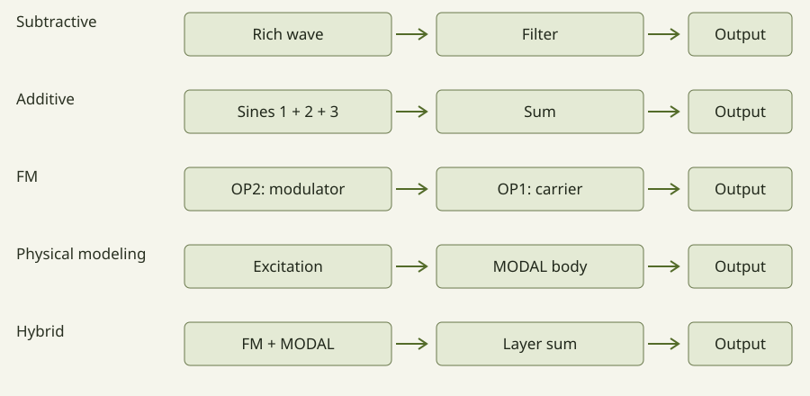

# Usina manual · ALPHA

[Português](README.md) · [Installation](../INSTALL.en.md) · [Alpha notice](../ALPHA.md#en) · [Home](../README.en.md)

User guide for the plugin/Standalone edition being prepared for **v0.2.0-alpha.1**. Features and labels require confirmation against the distributed version. The web edition and the APK have their own interfaces and workflows; this manual does not promise parity between editions.

## Chapters

| Find | Chapter |
|---|---|
| First sound, controls and performance | [This guide](#five-minutes) |
| Algorithms, operators, filters and effects | [Module guide](modules.en.md) |
| FILTER 2, stereo, LPG and capture | [Voices, filters and capture](voices.en.md) |
| Routes and seven patch examples | [Modulation in practice](modulation.en.md) |
| AUX sends and global feedback | [AUX and LOOP INSERT](routing.en.md) |

Choose where to begin and explore at your own pace. This guide combines gestures, images and examples. Uppercase names match the controls; terms are explained as you meet them.

<!-- guide-start -->

## Five minutes

### Your first sound

A **DAW** hosts the plugin; **Standalone** is the independent application. A **preset** stores a sound's settings. Start this exercise at low volume with audio input muted. If you are already exploring a sound, **SAVE** before pressing **INIT**: it does not undo edits.

*Real interface map: INIT and SAVE are at the top. OP1 is the first card to the right of the algorithm; selecting it opens its controls on the OPERATOR page below.*

1. Press **INIT**: OP1 starts with a sine wave, a simple tone; the other operators start with LEVEL at zero.
2. Open **PLAY** and play an on-screen key or your MIDI controller. Hold and release the same note. If silent, check audio output and MIDI input before raising levels.
3. Return to **SYNTH > OP1 > OPERATOR**. Increase **ATTACK** and play again: the sound should fade in more slowly.
4. Restore a short attack and increase **RELEASE**. Release the key: the sound should now take longer to disappear.
5. Compare one change at a time and **SAVE**. You have edited an envelope: how level changes over time, not an audio recording.

*PLAY groups performance controls; SYNTH edits the sound they play. This capture uses ORGAN; you do not need three keyboards for the exercise.*

### Hear what a modulator does

Save the previous exercise and return to INIT. In ALGO 1, OP2 feeds OP1. OP1 is the **carrier**, which reaches output; OP2 is the **modulator**, which transforms it. The line between the blocks shows the connection.

Select **OP2** and gradually raise its **LEVEL** from 0 to about 20, repeating the same note. OP1's sound gains new components. Compare OP2 **COARSE** at 1 and 2: the frequency relationship changes the transformation's character. Return LEVEL to zero to hear the sound without that modulation. **RATIO** is a relationship to the played note, not a second keyboard note.

### A short history of FM

In 1967, John Chowning explored computer-based frequency modulation synthesis at Stanford: simple oscillations could produce rich spectra. [Source: MIT](https://arts.mit.edu/people/john-chowning/).

In 1983, the DX7 brought FM synthesis to a broad musical audience. [Source: Yamaha history](https://www.yamaha.com/en/about/history/innovation/episode-15/). Bells and keyboards are familiar examples, but do not define its limits. Usina also combines other sources and processors; learn each mode gradually, listening to one change at a time.

### From FM to several techniques in one engine

Usina starts from FM's operator organization and expands what each operator can do. The goal is a broad range of timbres reached through different methods, with several synthesis techniques in one engine. You do not have to choose one technique for the entire instrument: each operator can play a different role.

*Simplified signal diagrams, not numbered algorithms. Arrows mean “feeds”; summing blocks combine outputs. Not every connection performs FM: MODE determines the processing.*

#### Subtractive: start rich and remove

**Example:** a harmonically rich wave passes through the voice filter. In SYNTH, keep one audible output active, choose a rich waveform in WAVE and open **FILTER / EG2 / OUTPUT**. Select a low-pass type and lower **CUTOFF**. Compare open and closed: high frequencies become less prominent. **RESO** emphasizes the cutoff region; **EG2** can move that opening during a note. Start with moderate resonance.

#### Additive: build by summing

**Example:** three sine waves at ratios 1, 2 and 3 reach output directly. In **ALGO > USER**, zero the operator connections and enable only OUT for OP1, OP2 and OP3. Set MODE FM, WAVE SIN and COARSE to 1, 2 and 3, with neutral FINE and FB/WIDTH off. Start at low LEVEL on all three. Raise one contribution at a time: you are building a spectrum by addition, without operators modulating each other. Different envelopes let each component evolve independently. This is an additive approach using the available operators, not an editor for hundreds of partials.

#### Traditional FM: one oscillation transforms another

**Example:** OP2 modulates OP1, both in FM/SIN. INIT supplies this starting point: OP1 reaches output; gradually raise OP2 LEVEL. The modulator's frequency relationship and level change the distribution of partials. FM mode uses phase modulation, a technique related to FM synthesis; its name does not mean that every Usina connection works this way.

#### Physical modeling: excite and let resonate

**Example:** an impact excites a resonant body. After INIT, select **MODAL** for OP1. Choose excitation in **EXCITER**; in **OBJECT**, compare **MATERIAL**, **SIZE** and **DECAY**, one change at a time. You control model properties rather than adding each partial manually. The envelope shapes excitation; resonance has its own decay. **DAMP** lets you explore damping after key release.

#### Hybrid: different techniques in one sound

**Example:** an FM attack and a MODAL tail. In USER, keep only the OP2-to-OP1 connection; enable OUT for OP1 and OP3. Set OP1/OP2 to FM and OP3 to MODAL. Use a short envelope for the FM layer and a longer decay for MODAL; balance their levels. The layers reach output in parallel. Compare each by zeroing its LEVEL, then combine them. This does not require the FM layer's audio to excite MODAL.

**Heterodox FM** describes that freedom: retaining the operator network while allowing other sources and transformations within it. It is not an additional menu mode. A connection may perform modulation, filtering or another process depending on MODE; the algorithm organizes the path and the mode determines what each block does.

### Continue exploring

Try a preset from the top library; the arrows browse the current category. Follow the [sound selection](../SOUNDS.md#en) for a guided tour. Macros only affect assigned destinations: an unassigned macro may change nothing.

## The screen and signal

The header holds the library, INIT, SAVE, LOAD and **SYNTH, FX, SEQ, CABINE, PLAY** views. SYNTH shows six operators and their algorithm roles. Select an operator to edit it. Lower pages separate **OPERATOR**, **FILTER / EG2 / OUTPUT** and **MOD**.

An **operator** is a sound source or processor with its own frequency, level and envelope. A **voice** is the operator network and filter triggered by a note. An **instance** shares effects, input/feedback and output.

The algorithm determines which operators reach the output and which feed others. A loud operator can be inaudible directly because it modulates another. USER's connection matrix allows custom links. Change one connection at a time and compare.

*Conceptual diagram: an arrow means one signal feeds the next block, not the controls' position on screen.*

## Frequency, level and envelopes

**RATIO** relates operator frequency to the played note: x1 follows the fundamental; higher ratios create higher relationships. **COARSE** chooses the main ratio; **FINE** refines it. **DETUNE** adds a fine offset; **TRANS** transposes. **FIXED** uses a fixed frequency. Dimmed values are inactive in that configuration.

On a carrier, **LEVEL** changes loudness; on a modulator it mainly changes the transformation of the next operator. **VEL** controls note-velocity influence. Devices may label octaves differently: compare actual pitch or MIDI note number when diagnosing a mismatch.

| Envelope control | Meaning |
|---|---|
| ATTACK | Time to reach the initial peak |
| DECAY | Time from peak to sustain |
| SUSTAIN | Held level, not a duration |
| RELEASE | Exit time after release |

The diagram shows the attack peak, decay end and release end. Where direct graph editing is available, **three handles can edit four parameters:** D/S changes decay time horizontally and sustain level vertically. The drawn sustain width is illustrative; sustain follows how long the key is held. Graph gestures differ between editions.

*Illustration without a fixed time scale: height means level and width means time.*

ATK CURVE, CURVE and REL CURVE shape the stages. `= DEC` uses decay's curve for release. **ADR** runs attack, decay and release without holding sustain. **RETRIG** chooses a source to strike the envelope again while the key is held. **RATE KEY** varies envelope times by pitch.

## Operator modes

A–D change meaning with MODE. Read their labels rather than relying on a knob position to always mean the same thing.

| Mode | Purpose | Specific controls |
|---|---|---|
| FM | A wave receiving phase modulation | FB, WIDTH |
| RING | Signal multiplication and metallic relationships | DEPTH, SHAPE |
| FILTER | Filter the received signal and mix an oscillator | TYPE, OSC MIX, CUTOFF, RESO |
| FILTER FM | Combine filtering and modulation | TYPE, CUTOFF, RESO |
| FOLD | Fold a waveform into more complex shapes | GAIN, OSC MIX, BIAS |
| EFFECT | Processing inside the operator algorithm | FX, OSC MIX; remaining labels depend on effect |
| BYPASS | Pass the received signal | No dedicated mode controls |
| MUTE | Silence that operator | No dedicated mode controls |
| MODAL | An object responding to excitation | STRUCTURE, OSC MIX, SIZE, DECAY; OBJECT and EXCITER pages |
| CHAOS | Chaotic processes | MODEL, CHAOS, SHAPE, SMOOTH |
| STOCHASTIC | Evolving stochastic waveforms | DISTRIB, LVL STEP, POINTS, LEN STEP |
| MACRO | Selectable synthesis models | MODEL, HARMONICS, TIMBRE, MORPH |
| SAMPLE | A recording used as an operator | READ, START, LENGTH, XFADE or FADE |
| UNISON | Stacked, slightly detuned copies | VOICES, DETUNE, MIX, DRIFT; SUB and PWM |
| BITS | Transform a wave's digital representation | BITS, XOR, KEEP, OFFSET |

The **MACRO operator mode is separate from the four performance macros**. An EFFECT operator is also separate from an FX page slot.

### MODAL objects

Choose STRUCTURE and MATERIAL, then explore SIZE and DECAY. BRIGHT, STIFF, POSITION, DENSITY and IRREG shape the response. The operator envelope shapes the excitation—the hand touching the object—while the object can keep resonating afterwards.

EXCITER offers STRIKE, BOW, BLOW, SCRAPE and **DROP**, which produces a falling, bouncing object. PRESSURE changes the interaction; TENSION makes pitch respond to movement; RATTLE adds noisy contact. **DAMP** adds damping after key release without changing the held note. Explore one structure and excitation before combining it with FM.

### UNISON and BITS

UNISON's VOICES selects 1–9 copies; DETUNE spreads pitch; MIX balances the centre and side copies; DRIFT adds slow independent movement. SUB adds a square one octave below. PWM affects compatible pulse waves. More copies cost more processing; these are not independent instrument parts.

BITS selects resolution; XOR transforms bits; KEEP removes some; OFFSET shifts the code with wraparound. Compare using it as an audible source and as a modulator: the same operation may sound very different.

## Filter, EG2 and LPG

In **FILTER / EG2 / OUTPUT**, choose filter type, then adjust CUTOFF, RESO and DRIVE. Cutoff locates the transition region; resonance emphasizes its neighbourhood. Low-pass, high-pass and band-pass responses differ; check type before repeating a gesture.

**EG2** means *Envelope Generator 2*, here associated with the filter. An envelope describes a change over time after a note event. EG2 INT sets how much it moves cutoff; it is not output volume. Do not confuse it with the separate source called ENV 2 in MOD.

**VCA** means *Voltage-Controlled Amplifier*. The name comes from electronic instruments; in software, a control signal can change gain without a physical control voltage. Think of it as a stage that opens and closes the level of the sound. An envelope can shape its attack and tail, or an LFO can make it pulse. This does not specifically remove high frequencies as a low-pass filter does; saturating stages can also change timbre.

**LPG** means *Low-Pass Gate*. It combines level control and low-pass filtering, so a closing gate tends to make the sound both quieter and darker. This can suit plucked or struck sounds. It is not a threshold-based noise gate.

In SYNTH → FILTER / EG2 / OUTPUT, the LPG follows the voice filter. OFF bypasses it, PING triggers a percussive response per note, and EG2 follows the filter envelope. DECAY changes closing time; COLOR controls high-frequency bleed, with lower values sounding darker. Recent plugin versions also offer SOURCE to follow a chosen modulation source; check the edition you use.

Try a bright sustained sound at a comfortable level. Compare OFF and PING, increase DECAY, then compare low and high COLOR. If the operator envelope ends first, it can hide the LPG tail. LPG DECAY and operator RELEASE are separate controls. CASC VCA belongs to the cascade filter and selects its level-control source; it is neither LPG nor the master volume.

## Modulation at the destination

Use the destination knob's **+**, select a source, then adjust its coloured bipolar **mini knob**. Dragging a source onto a knob is another assignment path. Positive depth follows the source; negative depth reverses its influence. Removing the route disconnects it; zero depth retains a connection with no effect.

Several sources can reach one destination. Base value and route depth are different settings. Try **LFO 1 → CUTOFF** with a small depth, or velocity to a modulator's level for touch-sensitive brightness.

MOD groups keyboard/expression, envelopes, LFOs, functions, random sources, combiners, macros and controllers. SEQ 1–4 are also sources. Source drawings help follow movement. A stationary source may depend on a held note, transport or an input receiving no signal.

**RAND 1–3 have RISE and FALL**, independently smoothing upward and downward changes. RANDOM LOOP repeats steps; LENGTH sets loop length and FLIP the chance of replacing a step. SAMPLE & HOLD produces new plateaus; BINARY produces two states with PROBA and CORREL. Smoothing differs from random event rate.

**COMB 1–3** offer SUM, DIFF, MULTIPLY, DIVIDE, CROSSFADE, LAG, THRESHOLD, OFFSET, REMAP, FOLLOWER, MIN, MAX and INPUT LEVEL. LAG slows a source's response; FOLLOWER follows a source's level; INPUT LEVEL responds to audio input level. This is not sung-note recognition.

Binary combiners interpret a source as an eight-bit code: BIT extracts a bit as a gate, XOR combines codes, AND retains high or low bits depending on AMOUNT, and ADD MOD 256 sums with wraparound. A ramp through BIT can create related rhythmic patterns. These are control processes, separate from the audio operator BITS.

## Effects and routing

Select a slot in **FX A, FX B, AUX or LOOP INSERT**, choose its type, then edit its panel. Each bus has three slots. NONE leaves a slot empty. Types are TEXTURE, ROOM, DISTORT, IR, VAPOR, DELAY and FILTER.

- **A/B:** voice effects; ROUTING chooses A > B, B > A or A // B.
- **AUX:** send/return; PRE takes signal before A/B, POST after.
- **LOOP INSERT:** processes the internal feedback loop.

TEXTURE provides granular/delay processing and different media; time, size, density, pitch, shape, freeze and space depend on mode. ROOM is reverberation; AMOUNT shapes its length/presence, with send and return determining presence in AUX. DISTORT provides nonlinear shaping with character, symmetry and tone.

IR convolves with an impulse response you recorded, downloaded for free or purchased, subject to its usage terms. You do not need to create it yourself; none are bundled. Permission to use an IR does not necessarily include permission to redistribute its original file with a preset. VAPOR offers GRANULAR, STRETCH, LOOP DELAY, SPECTRAL, REVERB and RESONATOR, with FREEZE/REVERSE where applicable. High density and feedback can accumulate energy. Its new internal LIMIT is optional, off by default, and does not replace the output guard.

DELAY's DIGITAL character transitions to a new time; TAPE glides pitch when TIME changes and offers WOW/FLUTTER. SYNC selects a tempo division; FREE uses TIME. FREEZE holds the echoes and TAP sets timing from your taps.

FILTER provides bus filtering with TYPE, CUTOFF, RESO, DRIVE, SPREAD, FOLLOW and MIX. FOLLOW is bipolar percent, not dB gain; see [FILTER in FX slots](voices.en.md#filter-in-fx-slots).

Effect MIX and bus MIX are distinct stages. AUX returns processed signal and uses SEND/RETURN. If a change is inaudible, check slot, effect/bus enable, mix and routing before adding gain.

## SAMPLE: capture and transform

SAMPLE participates in the operator algorithm. It can reach output, excite MODAL or modulate another operator.

1. Select **MODE → SAMPLE**.
2. Choose recording slot **A–D**. LOAD accepts WAV, AIFF, FLAC, OGG or MP3; CAPTURE records input; CLEAR clears the selected recording.
3. Configure the input in your host/Standalone and check IN GAIN. Capture is taken before IN MIX, so IN MIX can stay at zero without monitoring the microphone through the synth.
4. Capture LENGTH offers FREE for manual stop, or 1, 2, 4 bars. With host transport running, capture waits for the next bar. When stopped, it starts immediately and lasts the selected bars at the host tempo.
5. AUTO LVL targets −3 dBFS peak with at most +30 dB gain. Noise rises with signal; normalization cannot repair clipped input.
6. READ selects ONCE, LOOP, PING-PONG or REVERSE. START and playback LENGTH select a region. XFADE smooths LOOP's seam; FADE shapes reading edges in other modes.

Capture LENGTH is how long to record; playback LENGTH is how much of the recording to read. Manual capture has a 20-second limit; loaded recordings have a 30-second limit. The active mono recording is shared by SAMPLE operators in the patch. A–D are recording slots, not four simultaneous instrument parts.

Capture finishes into the slot where it started even if you select another. **SAMPLE CAPTURE** starts/stops or cancels waiting; **SAMPLE CAPTURE (held)** follows a held button; **SAMPLE A..D** select recordings. These can be learned as controller actions.

Presets/sessions store recording paths, not embedded audio. Move recordings and IRs with your work. MISSING means a referenced file needs restoring/reloading. Record and share only material you have permission to use, especially other people's voices and music.

## SEQ

Choose LANE first: NOTES, SEQ 1–4 or DRUM 1–4. Each lane may have different length, direction and clock division. Pages show steps; STEP edits the selected step's note, velocity, gate, probability, condition, ratchet and accent.

Chords and durations are part of the evolving format. Confirm the delivered edition before exchanging sessions among plugin, web and APK. Advanced app piano-roll features are not promised in this plugin alpha.

EUCLID, RANDOM, MUTATE and CLEAR affect the selected lane; save before generating or clearing. SEQ 1–4 become modulation sources; disabled steps hold their last value. The plugin follows DAW transport/tempo; Standalone has its own PLAY/BPM. Connecting devices by MIDI does not automatically synchronize them.

## CABINE and controllers

Seven surfaces: **ROTAS, SONS, GESTOS, DRUMS, MELODY, KEYS, USER**. The plugin retains physical Launchpad support and a virtual grid; its free native presentation is evolving. New web/APK layouts must not be mistaken for already delivered plugin features.

| Surface | Main use |
|---|---|
| ROTAS | Source rows and destination columns; grid taps cycle OFF, +50%, +100%, −50%, OFF |
| SONS | Presets; grid pages hold 56 sounds |
| GESTOS | Four macros, cutoff, resonance, paired A/B mix and AUX send |
| DRUMS | Four step lanes, accents, mute and selection |
| MELODY | Melody steps and scale keys for assigning notes |
| KEYS | Isomorphic playing grid with scale, root and octave |
| USER | TAP, preset changes, freezes and momentary macro/effect gestures |

SESSION's bottom grid row sets Macro 1/2 to four levels; tapping the selected level returns to zero. Held USER gestures return when released. Launchpad Mini MK3 pads do not measure velocity; KEYS uses fixed velocity. The hardware is not required for the on-screen CABINE.

Use AUTO for a direct Launchpad connection. Avoid the DAW and direct connection opening the same controller port. Physical layer buttons retain repeated-press access to extra modes. Other controllers need their own mapping.

### MIDI learn, forget, pitch bend and MPE

Right-click a knob → MIDI LEARN, then move an absolute CC. Right-click → FORGET CC removes it. Relative encoders are not supported. Native learn may apply incoming values immediately; do not assume the APK's pickup behavior exists in the plugin.

In ACTIONS, select an action, LEARN a note/CC, or FORGET it. A control note should not also trigger the synth. CTRL 1–8 in MOD turn notes/CCs into sources. EXPORT MAP / IMPORT MAP save `.usinamap` maps. Mappings also travel with sessions and can be defaults for new instances. Other people's controllers may send different messages.

In **MOD → KEYBOARD**, MASTER BEND sets ordinary bend range. **MPE INPUT → LOWER ZONE / CH 1 MASTER** uses channel 1 as master and 2–16 for per-note expression. Match NOTE BEND to the controller. Route AFTERTOUCH and TIMBRE to hear pressure/CC74; receiving expression does not mean a preset uses it.

A phone controller depends on its app and MIDI transport. USB, BLE and Web MIDI availability differ by system. Universal controller compatibility or inter-device synchronization is not claimed.

## PLAY

ORGAN offers manuals; GRID uses a scale layout. VEL TOUCH uses position within a key for velocity where available. All manuals share one patch; this is not a multitimbral instrument.

HOLD keeps released notes sounding; a new chord replaces them. Turning HOLD off releases retained notes. Changing views is not a panic command: HOLD may continue.

**A–D store four macro positions**, not complete presets or audio. An empty slot stores; recalling a filled slot moves macros over GLIDE time. In the plugin, Shift-click stores and the context menu offers STORE/CLEAR. XY mixes the four corners; an empty corner means macros at zero.

REC arms the next XY gesture recording; LOOP repeats it. Touching XY returns to manual control. LOCK prevents storing/deleting and arming REC; it does not silence output. Storage labels/gestures differ in web/APK.

## Saving, input and safety

SAVE writes `.usina` sound data, routes, functions, effects and sequence. LOAD retains equipment settings such as input, level, quality and mappings; feedback returns off. A preset does not replace a DAW-session backup. Preserve referenced recordings and IRs too.

IN GAIN sets input gain; IN MIX sets its audible contribution. **> FX** routes input through the effects instead of adding it dry after them. Start with IN MIX and FEEDBACK at zero. For feedback, use small changes and rehearse stopping the signal in your host.

The output guard handles invalid values, DC, peaks and sustained energy; feedback suppression acts on the external path. These cannot know headphone/speaker acoustic level or control gain applied after the plugin. **A limiter cannot guarantee safe hearing.**

For unexpected sound, lower physical volume first and stop playback/input; release notes and check HOLD, sustain, SEQ and feedback before resuming. Avoid investigating with headphones on at high volume.

## Reference glossary

Look here when a term is unfamiliar. These are short definitions, not prerequisites for playing. The earlier exercises show how to use the controls.

| Label | Meaning |
|---|---|
| FM | Frequency modulation; operators influence other operators. The FM mode receives phase modulation |
| OSC | Oscillator: a waveform source; an operator can also be a processor |
| VCA | Voltage-controlled amplifier by historical terminology; a digitally controlled gain stage here |
| VCF / FILTER | Filtering; reduces or emphasizes frequency regions without requiring an external voltage |
| LPG | Low-pass gate: level and brightness respond together |
| EG / ENV | Envelope generator; confirm which operator or modulation envelope is selected |
| ADSR | Attack, Decay, Sustain, Release; sustain is a level, not a duration |
| LFO | Low-frequency oscillator used as a modulation source |
| GATE | A held/open state; its meaning depends on the control |
| TRIGGER / PING | An event that initiates an action |
| CUTOFF / RESO | Filter transition region and resonance emphasis |
| DRIVE | Excitation of a nonlinear stage; not simply final output volume |
| RATIO / FIXED | Frequency relative to the note, or an independently chosen frequency |
| S&H | Sample and hold: retain a value until the next update |
| AUX / SEND / RETURN | Parallel bus, amount sent, and processed contribution returned |
| IR | Impulse response used for convolution; its file has its own usage terms |
| MIDI / CC | Musical control messages / Control Change; these are not audio |
| MPE | MIDI Polyphonic Expression: per-note expression with compatible input and settings |

## Limits and FAQ

- **Ready for a show?** This is alpha. Rehearse on the same version/equipment and keep an alternative. Failure-free operation is not promised.
- **macOS?** No native release yet. The web edition is separate.
- **Higher oversampling always better?** It costs CPU. Listen and watch load; no universal ideal setting is claimed.
- **Send only a preset?** Referenced audio/IRs may be missing. Share only material you are authorized to distribute.
- **Every source to every parameter?** Lists and type choices are not equivalent to continuous knob destinations. The delivered interface shows available assignments.
- **Planned features?** Sketch banks, complete-preset morphing, image-driven sequencing, pitch recognition, automatic slicing and independent parts are not promised in this alpha.
- **Future compatibility?** File preservation is an intention, not a guarantee of opening or identical sound during alpha.

For problems, use Issues with version, format, system, DAW and steps. See [contributing](../CONTRIBUTING.md#en) and [credits](../THIRD_PARTY.md).

## Third-party notices

See `THIRD_PARTY_NOTICES.txt` in the binary packages for licence texts of inventoried dependencies, alongside the package's other notices and licences.

This software is based in part on the work of the Independent JPEG Group.

Launchpad is a trademark of Focusrite Group PLC. VST is a trademark of Steinberg Media Technologies GmbH, registered in Europe and other countries. These names identify compatibility; Usina is not affiliated with these companies.
