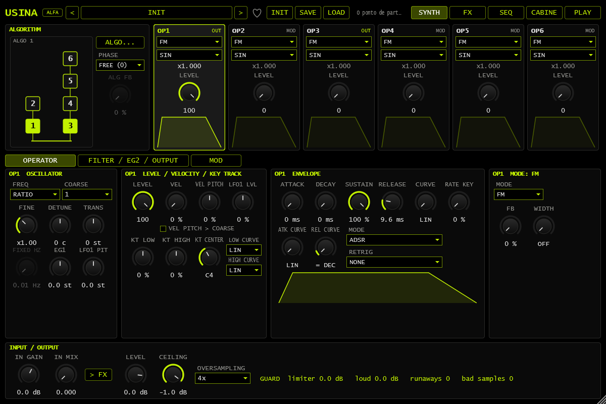
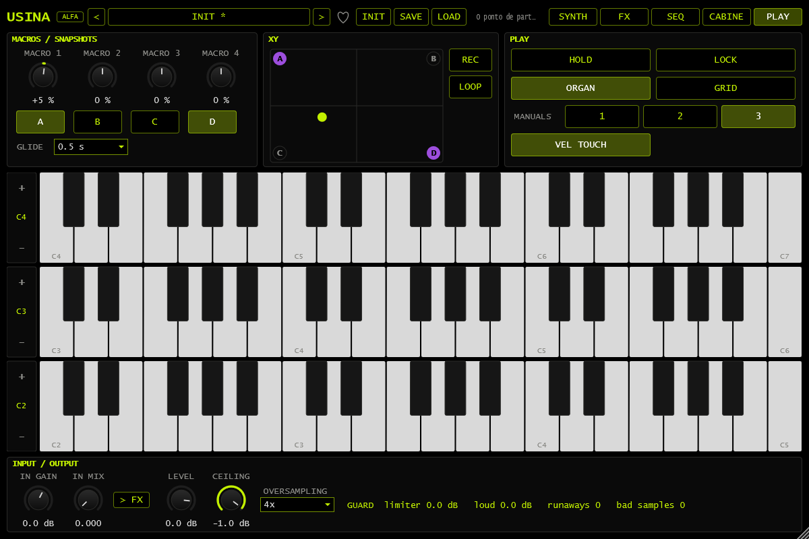
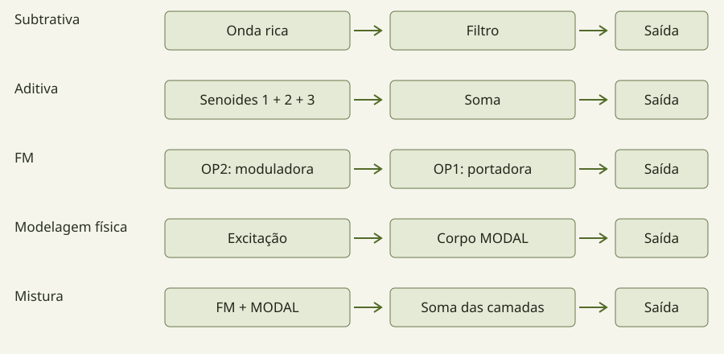
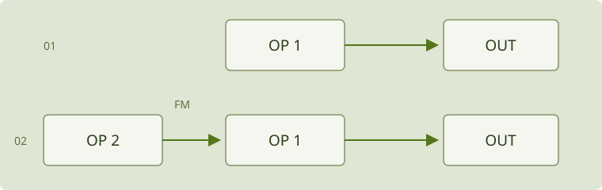
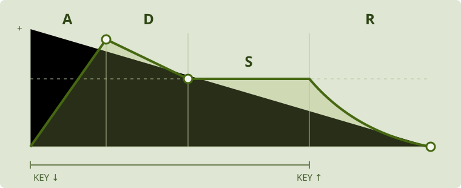
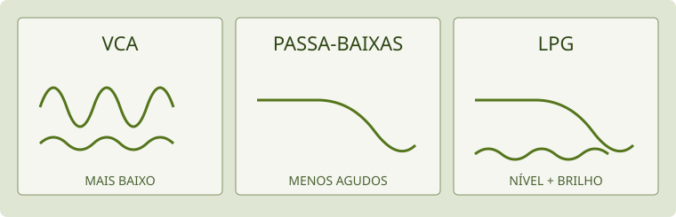

# Manual do Usina · ALFA

[English](README.en.md) · [Instalação](../INSTALL.md) · [Aviso do alfa](../ALPHA.md) · [Página inicial](../README.md)

Guia de uso da edição plugin/Standalone em preparação para **v0.2.0-alpha.1**. Rótulos e recursos devem ser conferidos na versão distribuída. A edição web e o APK têm interfaces e percursos próprios; este manual não promete paridade entre edições.

## Capítulos

| Para consultar | Capítulo |
|---|---|
| Primeiro som, controles e performance | [Este guia](#em-cinco-minutos) |
| Algoritmos, operadores, filtros e efeitos | [Guia por módulo](modules.md) |
| FILTER 2, estéreo, LPG e captura | [Vozes, filtros e captura](voices.md) |
| Criar rotas e comparar sete patches | [Modulação na prática](modulation.md) |
| Envio AUX e realimentação global | [AUX e LOOP INSERT](routing.md) |

Você escolhe por onde começar e em que ritmo explorar. Este guia combina gestos, imagens e exemplos. Os nomes em maiúsculas são os que aparecem nos controles; cada termo é explicado quando entra no caminho.

<!-- guide-start -->

Para consultar cada tipo de operador, filtro e efeito e localizar seus controles, abra o [guia por módulo e mapa das telas](modules.md).

## Em cinco minutos

### Seu primeiro som

**DAW** é o programa que hospeda o plugin; **Standalone** é o aplicativo independente. Um **preset** guarda os ajustes de um timbre. Para este exercício, comece com volume baixo e a entrada de áudio muda. Se já estiver explorando um som, use **SAVE** antes de pressionar **INIT**: ele não desfaz alterações.

*Mapa da interface real: INIT e SAVE ficam no topo. OP1 é o primeiro cartão à direita do algoritmo; selecioná-lo abre seus controles na página OPERATOR abaixo.*

1. Pressione **INIT**: OP1 começa com uma senoide, um som simples; os outros operadores começam com LEVEL em zero.
2. Abra **PLAY** e toque uma tecla na tela ou no controlador MIDI. Segure e solte a mesma nota. Se não ouvir, confira a saída de áudio e a entrada MIDI antes de aumentar níveis.
3. Volte a **SYNTH > OP1 > OPERATOR**. Aumente **ATTACK**, tocando novamente: a entrada do som deve ficar mais lenta.
4. Volte a um ataque curto e aumente **RELEASE**. Agora solte a tecla: o som deve levar mais tempo para desaparecer.
5. Compare uma mudança de cada vez e use **SAVE**. Você acabou de editar um envelope: a evolução do nível no tempo, não uma gravação de áudio.

*PLAY reúne controles de execução; SYNTH edita o som que eles tocam. A captura usa ORGAN; não é necessário usar três teclados para este exercício.*

### Ouça o que uma moduladora faz

Salve o exercício anterior e volte a INIT. No ALGO 1, OP2 alimenta OP1. OP1 é a **portadora**, que chega à saída; OP2 é a **moduladora**, que a transforma. A linha entre os blocos mostra a conexão.

Selecione **OP2** e aumente seu **LEVEL** aos poucos, de 0 até cerca de 20, repetindo a mesma nota. O som de OP1 ganha componentes novas. Compare **COARSE** de OP2 em 1 e em 2: a relação de frequência muda o caráter da transformação. Volte LEVEL a zero para ouvir o som sem essa modulação. **RATIO** é uma relação com a nota tocada, não uma segunda nota do teclado.

### Uma breve história da FM

Em 1967, John Chowning explorou a síntese por modulação de frequência no computador em Stanford: oscilações simples podiam produzir espectros ricos. [Fonte: MIT](https://arts.mit.edu/people/john-chowning/).

Em 1983, o DX7 levou a síntese FM a um público amplo de músicos. [Fonte: história da Yamaha](https://www.yamaha.com/en/about/history/innovation/episode-15/). Sinos e teclados são exemplos conhecidos, mas não limitam a técnica. O Usina também combina outras fontes e processadores; você pode conhecer cada modo aos poucos, ouvindo uma mudança de cada vez.

### Da FM a várias técnicas no mesmo motor

O Usina parte da organização da FM e amplia o papel dos operadores. O objetivo é alcançar uma gama ampla de timbres por caminhos diferentes e permitir várias técnicas de síntese em um só motor. Não é preciso escolher uma técnica para o instrumento inteiro: cada operador pode ter um papel diferente.

*Diagramas de sinal simplificados, não números de algoritmos. As setas significam “alimenta”; os blocos de soma reúnem saídas. Nem toda ligação faz FM: MODE determina o processamento.*

#### Subtrativo: começar rico e retirar

**Exemplo:** uma onda rica em harmônicos passa pelo filtro de voz. Em SYNTH, deixe uma saída sonora ativa, escolha uma onda rica em WAVE e abra **FILTER / EG2 / OUTPUT**. Escolha um tipo passa-baixas e reduza **CUTOFF**. Compare aberto e fechado: as frequências altas perdem presença. **RESO** enfatiza a região de corte; **EG2** permite fazer essa abertura mudar durante a nota. Use ressonância moderada ao começar.

#### Aditivo: construir pela soma

**Exemplo:** três senoides nas relações 1, 2 e 3, chegando diretamente à saída. Em **ALGO > USER**, zere as conexões entre operadores e deixe apenas OUT de OP1, OP2 e OP3 ligados. Use MODE FM, WAVE SIN e COARSE em 1, 2 e 3, com FINE neutro, FB e WIDTH desligados. Comece com LEVEL baixo nos três. Aumente uma contribuição de cada vez: você está compondo um espectro por soma, sem um operador modular outro. Envelopes diferentes fazem cada componente evoluir no seu tempo. É uma abordagem aditiva com os operadores disponíveis, não um editor de centenas de parciais.

#### FM tradicional: uma oscilação transforma outra

**Exemplo:** OP2 modula OP1, ambos em FM/SIN. INIT oferece esse ponto de partida: OP1 é a saída; aumente LEVEL de OP2 aos poucos. A relação de frequência e o nível da moduladora mudam a distribuição de parciais. O modo FM usa modulação de fase, técnica relacionada à síntese FM; o nome não significa que toda ligação do Usina opere dessa forma.

#### Modelagem física: excitar e deixar ressoar

**Exemplo:** um impacto excita um corpo ressonante. Após INIT, escolha **MODAL** em OP1. Em **EXCITER**, escolha a excitação; em **OBJECT**, compare **MATERIAL**, **SIZE** e **DECAY**, uma mudança por vez. Você controla propriedades do modelo, em vez de somar cada parcial manualmente. O envelope molda a excitação; a ressonância tem seu próprio decaimento. **DAMP** permite explorar o amortecimento depois de soltar a nota.

#### Mistura: técnicas diferentes no mesmo timbre

**Exemplo:** ataque em FM e sustentação em MODAL. Em USER, mantenha somente a ligação OP2 para OP1; deixe OUT de OP1 e OP3 ligados. Configure OP1/OP2 em FM e OP3 em MODAL. Use um envelope curto na camada FM e um decaimento mais longo no MODAL; equilibre os níveis. As camadas chegam à saída em paralelo. Você pode comparar cada uma zerando seu LEVEL e depois reuni-las. Isso não exige que o MODAL seja excitado pelo áudio da camada FM.

**FM heterodoxa** descreve essa liberdade: conservar a rede de operadores e permitir outras fontes e transformações nela. Não é um modo adicional no menu. Uma ligação pode realizar modulação, filtragem ou outro processo conforme MODE; o algoritmo organiza o percurso, e o modo define o que acontece em cada bloco.

### Para continuar explorando

Experimente um preset na biblioteca do topo; as setas percorrem a categoria atual. Siga o [percurso de timbres](../SOUNDS.md) para uma seleção guiada. Macros só afetam os destinos endereçados: uma macro sem destino pode não alterar o som.

## A tela e o caminho do som

O topo reúne biblioteca, INIT, SAVE, LOAD e as vistas **SYNTH, FX, SEQ, CABINE e PLAY**. Em SYNTH, a visão dos seis operadores mostra quem participa do algoritmo; selecionar um abre sua edição. As páginas inferiores separam **OPERATOR**, **FILTER / EG2 / OUTPUT** e **MOD**.

Pense em três escalas de trabalho:

- **Operador:** uma fonte sonora ou um processador, com frequência, nível e envelope próprios.
- **Voz:** o conjunto disparado por uma nota, combinando os operadores e o filtro.
- **Instância:** efeitos, entrada/realimentação e saída compartilhados pelo instrumento aberto.

O algoritmo decide quais operadores chegam à saída e quais alimentam outros. Um operador com nível alto pode não ser ouvido diretamente: ele pode estar modulando outro. A matriz USER permite desenhar ligações próprias. Mude uma ligação por vez e compare.

*Mapa conceitual: uma seta significa que um sinal alimenta o próximo bloco. O desenho explica a relação; não reproduz a posição dos controles na tela.*

## Frequência, nível e envelope

**RATIO** relaciona a frequência do operador à nota tocada: x1 acompanha a fundamental; razões maiores criam relações mais agudas. **COARSE** escolhe a relação principal, **FINE** a refina. **DETUNE** é um desvio fino e **TRANS** transpõe. **FIXED** usa frequência fixa; não espere o mesmo acompanhamento do teclado. Os valores apagados não estão ativos naquela configuração.

**LEVEL** de uma portadora muda seu volume; em um modulador, muda sobretudo o quanto ele transforma o operador seguinte. **VEL** define a influência da força da nota. O teclado e o controlador podem nomear oitavas de modos diferentes; compare pela altura ou pelo número MIDI ao diagnosticar uma diferença.

### ADSR e ADR

| Controle | O que se ouve |
|---|---|
| ATTACK | Tempo para o início crescer |
| DECAY | Tempo para descer do pico ao nível sustentado |
| SUSTAIN | Nível mantido enquanto a nota continua; não é uma duração |
| RELEASE | Tempo de saída depois de soltar |

Nas edições com edição direta do gráfico, as alças representam o pico do ataque, o fim do decaimento e o fim do release. **Três pontos móveis podem editar quatro parâmetros**: o ponto D/S altera tempo na horizontal e nível na vertical. A parte sustentada dura o tempo da tecla, não um tempo fixo desenhado no gráfico.

*Exemplo ilustrativo, sem escala de tempo fixa. A altura representa nível; a largura representa tempo.*

**ATK CURVE**, **CURVE** e **REL CURVE** mudam a trajetória. `= DEC` usa no release a curva do decay. **ADR** percorre ataque, decay e release sem manter o sustain pela tecla. **RETRIG** escolhe uma fonte que dispara novamente o envelope enquanto a nota está pressionada. **RATE KEY** faz os tempos variarem com a altura.

## Modos de operador

Os controles A–D mudam de significado conforme **MODE**. Use seus rótulos, não a posição do knob como lembrança de uma função fixa.

| Modo | Para explorar | Controles específicos |
|---|---|---|
| FM | Uma onda que recebe modulação de fase de outro operador | FB, WIDTH |
| RING | Multiplicação e relações metálicas entre sinais | DEPTH, SHAPE |
| FILTER | Filtrar o sinal do algoritmo e misturar o oscilador | TYPE, OSC MIX, CUTOFF, RESO |
| FILTER FM | Combinar filtragem e modulação no operador | TYPE, CUTOFF, RESO |
| FOLD | Dobrar a forma e aumentar sua complexidade | GAIN, OSC MIX, BIAS |
| EFFECT | Processamento dentro do algoritmo | FX, OSC MIX; os demais controles dependem do efeito |
| BYPASS | Passagem do sinal recebido | Sem controles de modo próprios |
| MUTE | Silenciar aquele operador | Sem controles de modo próprios |
| MODAL | Um objeto que responde à excitação | STRUCTURE, OSC MIX, SIZE, DECAY; painéis OBJECT e EXCITER |
| CHAOS | Movimento de sistemas caóticos | MODEL, CHAOS, SHAPE, SMOOTH |
| STOCHASTIC | Forma que evolui por processos aleatórios | DISTRIB, LVL STEP, POINTS, LEN STEP |
| MACRO | Um conjunto de modelos de síntese selecionáveis | MODEL, HARMONICS, TIMBRE, MORPH |
| SAMPLE | Ler uma gravação como operador | READ, START, LENGTH, XFADE ou FADE |
| UNISON | Empilhar cópias ligeiramente desafinadas da onda | VOICES, DETUNE, MIX, DRIFT; SUB e PWM |
| BITS | Transformar a representação digital da onda | BITS, XOR, KEEP, OFFSET |

**MACRO como modo de operador não é a mesma coisa que as quatro macros de performance.** E EFFECT dentro do algoritmo não é um slot da página FX.

### Um objeto em MODAL

Escolha uma **STRUCTURE** e um **MATERIAL**; mude SIZE e DECAY para ouvir proporção e duração. BRIGHT, STIFF, POSITION, DENSITY e IRREG modelam a resposta. O objeto continua ressoando depois da excitação; seu envelope molda a mão que o toca, não apenas um volume final.

Em **EXCITER**, STRIKE golpeia; BOW fricciona; BLOW sopra; SCRAPE raspa; **DROP** faz cair e quicar. PRESSURE muda a interação, TENSION permite altura dependente do movimento e RATTLE acrescenta contato ruidoso. **DAMP** amortece ao soltar a tecla, sem mudar a nota sustentada. Comece com um objeto e uma excitação, antes de combiná-los com FM.

### UNISON e BITS

Em UNISON, VOICES escolhe 1–9 cópias; DETUNE abre sua afinação; MIX equilibra o centro com as laterais; DRIFT acrescenta deriva lenta. SUB acrescenta uma quadrada uma oitava abaixo. PWM atua nas ondas de pulso compatíveis. Mais cópias custam mais processamento; não implicam várias partes independentes.

Em BITS, BITS escolhe a resolução, XOR transforma bits, KEEP remove parte deles e OFFSET desloca o código com retorno ao início da faixa. Experimente primeiro como fonte ouvida e depois como modulador: a mesma transformação pode ter efeito muito diferente nos dois papéis.

## Filtro, EG2 e LPG

Na página **FILTER / EG2 / OUTPUT**, escolha o tipo de filtro e então ajuste **CUTOFF**, **RESO** e **DRIVE**. Cutoff escolhe a região de transição; ressonância realça a vizinhança dela. Passa-baixas, passa-altas e passa-banda têm resultados distintos: observe o tipo antes de repetir um gesto.

**EG2** significa *Envelope Generator 2*: o segundo gerador de envelope, aqui associado ao filtro. Um envelope desenha como um valor muda depois de tocar e soltar uma nota. **EG2 INT** escolhe quanto esse desenho movimenta o corte; não é o volume de saída. EG2 e a fonte chamada ENV 2 em MOD não devem ser confundidos só por terem o número 2.

### VCA, filtro e LPG: o que muda no som?

**VCA** vem de *Voltage-Controlled Amplifier*, amplificador controlado por tensão. É um nome herdado dos sintetizadores eletrônicos: no software, um sinal de controle pode mudar o ganho sem existir uma tensão física. Pense nele como uma etapa que abre ou fecha a passagem do nível do som. Um envelope pode fazê-lo começar devagar, sustentar e desaparecer; um LFO pode fazê-lo pulsar. Isso não implica retirar especificamente os agudos, como faz um filtro passa-baixas. Etapas que também saturam podem acrescentar outras mudanças ao timbre.

**LPG** vem de *Low-Pass Gate*, ou porta passa-baixas. Combina duas ações: controlar o nível e filtrar os agudos. Ao fechar, o som tende a ficar **mais baixo e mais escuro**. Essa ligação entre perda de energia e de brilho ajuda a criar ataques e caudas que lembram cordas pinçadas e pequenos objetos percutidos. Não é um *noise gate* que abre ao detectar áudio acima de um limiar.

| Etapa | O que você percebe | Experimente |
|---|---|---|
| VCA | O nível cresce e diminui conforme o controle | Imagine o volume seguindo um envelope, preservando a forma básica do som |
| Filtro passa-baixas | Menos agudos à medida que o corte desce | Mova CUTOFF sobre uma nota com bastante brilho |
| LPG | O som perde nível e brilho juntos durante o fechamento | Compare OFF e PING com a mesma nota |

**Onde está no Usina:** abra **SYNTH → FILTER / EG2 / OUTPUT**. O LPG fica no grupo de saída, depois do filtro de voz. Em **OFF**, essa etapa é desativada; em **PING**, cada nota dispara uma resposta percussiva; em **EG2**, o LPG acompanha o envelope do filtro. **DECAY** muda o tempo de fechamento; **COLOR** muda quanto conteúdo agudo passa - valores menores soam mais escuros. O LPG DECAY não é o RELEASE do operador. A edição recente do plugin também oferece **SOURCE**, para seguir uma fonte de modulação; confira a disponibilidade na versão usada.

**Para ouvir a diferença:** salve seu timbre, escolha um som sustentado com harmônicos e deixe uma nota durar. Compare LPG OFF com PING usando DECAY curto. Depois aumente DECAY e compare COLOR baixo e alto, mantendo um volume confortável. Se o envelope do operador terminar antes, ele pode esconder a cauda do LPG: são duas etapas diferentes controlando a mesma voz.

O nome **CASC VCA**, no filtro em cascata, identifica outro controle: escolhe o que comanda o nível dessa etapa. Não é um segundo nome para LPG nem um volume mestre. O [guia por módulo](modules.md#vca-e-lpg-na-interface) detalha suas opções.

## Modulação no próprio destino

**[Abrir o guia de patches de modulação](modulation.md)** — exemplos passo a passo com mapas de rotas, desenhos e diagnóstico.

1. Localize o parâmetro que quer mover e seu **+** de endereçamento.
2. Escolha a fonte; a ligação aparece na bandeja de **mini knobs coloridos** do destino. A interface também permite arrastar uma fonte até o knob.
3. Arraste o mini knob para ajustar a profundidade bipolar. Positivo acompanha a fonte; negativo inverte sua influência.
4. Para limpar, remova a rota; quantidade zero mantém uma ligação sem efeito.

Um destino pode receber várias fontes. O valor de base do knob e a profundidade de cada rota são ajustes diferentes. Comece com **LFO 1 → CUTOFF** e uma quantidade pequena, ou **VELOCITY → nível de um modulador** para variar o brilho com a mão.

**MOD** reúne teclado/expressão, envelopes, LFOs, funções, aleatórios, combinadores, macros e controles. As pistas **SEQ 1–4** também são fontes. Os desenhos ajudam a acompanhar o movimento; uma fonte parada pode depender de nota, transporte ou de uma entrada sem sinal.

### RAND e COMB

**RAND 1–3 têm RISE e FALL**: suavizam separadamente subida e descida. RANDOM LOOP repete uma sequência; LENGTH define seu comprimento e FLIP a chance de mudar ao voltar. SAMPLE & HOLD produz novos patamares; BINARY produz dois estados, com PROBA e CORREL. Não confunda suavização com velocidade do sorteio.

**COMB 1–3** transformam fontes: SUM, DIFF, MULTIPLY, DIVIDE, CROSSFADE, LAG, THRESHOLD, OFFSET, REMAP, FOLLOWER, MIN, MAX e INPUT LEVEL. **LAG** atrasa a resposta suavemente; **FOLLOWER** acompanha o nível de uma fonte; **INPUT LEVEL** responde ao nível da entrada de áudio. Isso não equivale a reconhecer notas cantadas.

Os tipos binários leem a fonte como código de oito bits: **BIT** extrai um bit como porta; **XOR** combina códigos; **AND** conserva bits altos ou baixos conforme AMOUNT; **ADD MOD 256** soma e retorna ao início ao ultrapassar a faixa. Uma rampa em BIT pode gerar padrões relacionados. São processos de controle, distintos do modo sonoro BITS.

## Efeitos e seus lugares

Escolha um slot em **FX A**, **FX B**, **AUX** ou **LOOP INSERT**, escolha o tipo e edite seu painel. Cada barramento oferece três slots. **NONE** deixa o slot sem efeito. As opções são TEXTURE, ROOM, DISTORT, IR, VAPOR, DELAY e FILTER.

| Lugar | Uso |
|---|---|
| FX A / FX B | Barramentos das vozes; ROUTING escolhe A > B, B > A ou A // B |
| AUX | Caminho de envio e retorno; PRE capta antes de A/B, POST depois |
| LOOP INSERT | Processa o laço interno de realimentação |

- **TEXTURE:** processamento granular/delay e diferentes meios; tempo, tamanho, densidade, afinação, forma, freeze e espaço. Os rótulos dependem do modo.
- **ROOM:** reverberação; AMOUNT muda a sala e sua presença. No AUX, envio e retorno determinam a presença.
- **DISTORT:** transformação não linear com caráter, simetria e tom; compare em volume moderado.
- **IR:** convolução com resposta de impulso gravada por você, baixada gratuitamente ou comprada, conforme seus termos de uso. Nenhum IR acompanha o plugin; preserve o arquivo necessário ao seu trabalho. Usar um IR não significa ter permissão para redistribuí-lo.
- **VAPOR:** GRANULAR, STRETCH, LOOP DELAY, SPECTRAL, REVERB e RESONATOR; FREEZE e REVERSE quando aplicáveis. Densidade e feedback altos podem acumular energia. O novo LIMIT interno é opcional e começa desligado; não substitui a guarda de saída.
- **FILTER:** filtro de barramento com TYPE, CUTOFF, RESO, DRIVE, SPREAD, FOLLOW e MIX. FOLLOW é percentual bipolar; o detector usa uma escala de nível em dBFS. Veja o [guia de filtros](voices.md#filter-nos-slots-de-fx).
- **DELAY:** DIGITAL muda o tempo por transição; TAPE desliza a altura ao mudar TIME e oferece WOW/FLUTTER. SYNC escolhe uma divisão do andamento; FREE usa TIME. FREEZE mantém os ecos; TAP ajusta o tempo pela batida.

O MIX do efeito e o MIX do barramento não são a mesma etapa. No AUX, os efeitos retornam processados; SEND e RETURN determinam sua contribuição. Se não ouvir uma mudança, confira slot, efeito/barramento ligado, mix e roteamento antes de aumentar ganho.

## SAMPLE: gravar e transformar

SAMPLE é um operador do algoritmo. Pode ir à saída, excitar MODAL ou modular outro operador.

1. Selecione **MODE → SAMPLE** em um operador.
2. No painel da gravação, escolha **A, B, C ou D**. LOAD abre WAV, AIFF, FLAC, OGG ou MP3; CAPTURE usa a entrada. CLEAR limpa a posição selecionada.
3. Para capturar, configure a entrada no host ou Standalone. Confira IN GAIN. A captura usa o sinal antes de IN MIX: é possível gravar com IN MIX em zero, sem monitorar o microfone pelo synth.
4. Use LENGTH da captura em **FREE** para parar manualmente, ou **1, 2, 4 compassos**. Com o host tocando, ela espera o próximo compasso; parado, começa na hora e dura o tempo calculado pelo andamento.
5. **AUTO LVL** ajusta o pico para −3 dBFS, com ganho máximo de +30 dB. Pode elevar ruído junto do sinal; não recupera uma entrada já distorcida.
6. Toque e ajuste READ: ONCE, LOOP, PING-PONG ou REVERSE. START e LENGTH escolhem a região. XFADE suaviza a emenda de LOOP; nos demais modos, FADE ajusta as bordas da leitura.

**LENGTH da captura e LENGTH da leitura são diferentes:** um define quanto gravar, o outro quanto da gravação tocar. A captura manual tem limite de 20 s; arquivos carregados, 30 s. A leitura usa uma gravação mono compartilhada pelos operadores SAMPLE do patch; A–D são posições de gravação, não quatro partes simultâneas.

A captura termina na posição em que começou, mesmo que você selecione outra durante a gravação. As ações **SAMPLE CAPTURE**, **SAMPLE CAPTURE (held)** e **SAMPLE A..D** permitem controle por pads. A primeira alterna início/parada ou cancela a espera; a ação held acompanha o botão pressionado.

As gravações ficam em arquivos; presets e sessões guardam seus caminhos. Ao mover o projeto para outro computador, leve os áudios e IRs também. **MISSING** pede restaurar ou carregar novamente o arquivo. Use somente material que tenha direito de gravar e compartilhar, especialmente vozes e música de outras pessoas.

## SEQ

Escolha **LANE** antes de editar: NOTES, SEQ 1–4 ou DRUM 1–4. O comprimento, direção e divisão de relógio de cada pista podem diferir. A grade mostra páginas de passos; o painel STEP edita a seleção.

As notas combinam velocidade, gate, probabilidade, condição, ratchet e acento. Acordes e durações fazem parte da evolução do formato; confira a edição entregue antes de transportar sessões entre plugin, web e APK. Os recursos avançados do piano roll do app não são prometidos nesta edição do plugin.

**EUCLID**, **RANDOM**, **MUTATE** e **CLEAR** atuam na pista escolhida. Salve antes de gerar ou limpar. As quatro pistas de modulação tornam-se fontes SEQ 1–4; passos desligados mantêm o último valor. No plugin, o transporte e andamento são os da DAW; no Standalone há PLAY e BPM próprios. Conectar dois aparelhos por MIDI não os sincroniza automaticamente.

## CABINE e controladores

As sete superfícies são **ROTAS, SONS, GESTOS, DRUMS, MELODY, KEYS e USER**. Elas organizam a mesma performance em percursos diferentes. O plugin preserva o Launchpad físico e sua grade virtual; a apresentação livre nativa ainda está em evolução. Não confunda as telas novas do web/APK com recursos já presentes no plugin.

| Superfície | Gesto central |
|---|---|
| ROTAS | Linhas de fontes e colunas de destinos; na grade, toques percorrem OFF, +50%, +100%, −50%, OFF |
| SONS | Escolher timbres; a grade oferece páginas de 56 sons |
| GESTOS | Quatro macros, cutoff, ressonância, mix de A/B em conjunto e envio AUX |
| DRUMS | Quatro pistas de passos; força, mute e seleção por pista |
| MELODY | Passos de melodia e teclado em escala para atribuir notas |
| KEYS | Grade isomórfica com escala, tônica e oitava |
| USER | TAP, troca de som, freezes, macros e alterações momentâneas de efeitos |

Na grade SESSION, a última fileira oferece Macro 1 e 2 em quatro níveis; tocar novamente o nível selecionado volta a zero. Em USER, os controles segurados retornam ao soltar. O Launchpad Mini MK3 não mede velocity nos pads; KEYS usa força fixa. Não é preciso ter esse hardware para usar a CABINE na tela.

Para conectar diretamente o Launchpad, use **AUTO**. Se a porta estiver ocupada, deixe a porta de controle direta fora da seleção da DAW; uma porta não deve ser aberta duas vezes. Os botões físicos de camada preservam seus toques repetidos para modos extras. Não presuma que todo controlador usa o mesmo mapa.

### MIDI learn e forget

**Knobs:** botão direito → MIDI LEARN → mova um CC absoluto do controlador. Para remover, botão direito → FORGET CC. Encoders relativos ainda não são tratados. O learn nativo pode aplicar o valor recebido imediatamente; o comportamento de pickup da edição APK não deve ser presumido no plugin.

**Ações:** em ACTIONS, escolha a ação, use LEARN e pressione a nota/CC. FORGET remove. Uma nota usada como ação não deve também tocar o synth. CTRL 1–8 na página MOD permitem usar notas ou CCs como fontes.

**EXPORT MAP / IMPORT MAP** guardam mapas `.usinamap`. Mapeamentos também acompanham a sessão e podem servir como padrão de novas instâncias. Não envie seu mapa a outra pessoa presumindo que os controladores dela usam os mesmos CCs.

### Pitch bend e MPE

Em **MOD → KEYBOARD**, MASTER BEND define o alcance do bend comum. **MPE INPUT → LOWER ZONE / CH 1 MASTER** usa canal 1 como mestre e 2–16 para expressão por nota. NOTE BEND deve corresponder ao alcance do controlador. Enderece AFTERTOUCH e TIMBRE na matriz para ouvir pressão e CC74; receber uma mensagem não garante que o timbre a use.

O celular como controlador depende do transporte MIDI e da edição do app. Bluetooth, USB e Web MIDI não têm a mesma disponibilidade em todos os sistemas. Não anunciamos validação universal de controladores ou sincronismo entre aparelhos.

## PLAY

Escolha **ORGAN** para manuais ou **GRID** para a disposição em escala. VEL TOUCH usa a altura do toque para velocidade, quando disponível. Todos os manuais tocam o mesmo patch: não são partes multitimbrais.

**HOLD** mantém as notas soltas; um novo acorde substitui o anterior. Desligar HOLD solta as notas retidas. Trocar de vista não deve ser usado como pânico, pois o HOLD pode continuar.

**A–D guardam as quatro posições de macros**, não presets completos nem áudio. Uma posição vazia guarda; recuperar uma gravada move as macros pelo tempo de GLIDE. No plugin, Shift-clique guarda e o menu de contexto oferece STORE/CLEAR. O XY mistura os quatro cantos. Um canto vazio corresponde às macros em zero.

**REC** prepara a gravação do próximo gesto XY; **LOOP** repete o movimento gravado. Tocar novamente no XY retoma o controle manual. **LOCK** impede guardar/apagar e preparar REC; não é um comando para silenciar. Os nomes e gestos de armazenamento variam na edição web/APK.

## Salvar, entrada e segurança

**SAVE** grava `.usina` com o som, rotas, funções, efeitos e sequência. **LOAD** preserva ajustes de equipamento como entrada, nível, qualidade e mapeamentos; feedback volta desligado. Não use um preset como substituto de backup da sessão inteira da DAW. Preserve também os arquivos de gravação e IR.

IN GAIN ajusta entrada; IN MIX determina quanto entra no caminho audível. **> FX** encaminha a entrada pelos efeitos em vez de juntá-la seca depois deles. Comece com IN MIX e FEEDBACK em zero. Em realimentação, faça mudanças pequenas e ensaie a forma de interromper o sinal no seu host.

A guarda de saída trata valores inválidos, DC, picos e energia sustentada; a proteção contra microfonia atua no caminho externo. Nenhuma dessas camadas conhece a pressão sonora dos seus fones/caixas ou protege contra ganhos depois do plugin. **Não existe garantia de audição segura por instalar um limitador.**

Se houver som inesperado, reduza primeiro o volume físico e interrompa a reprodução/entrada; solte as notas e confira HOLD, sustain, SEQ e feedback antes de retomar. Evite começar a investigação com fones no ouvido e volume alto.

## Glossário de consulta

Consulte aqui uma palavra desconhecida. São definições curtas, não etapas obrigatórias antes de tocar. Os exercícios anteriores mostram como aplicar os controles.

Os nomes em inglês continuam nos controles. Esta tabela ajuda a reconhecer a função, sem precisar decorar a sigla antes de tocar.

| Nome na tela | Significado | Em termos de escuta ou gesto |
|---|---|---|
| FM | Modulação de frequência | Um operador influencia outro; quantidade e relação entre eles mudam o conteúdo do som |
| OSC / oscilador | Gerador de uma forma de onda | O ponto de partida de muitos sons; no Usina, operadores também podem ter outras funções |
| VCA | Amplificador controlado por tensão, por tradição | Uma etapa de ganho comandada por outro sinal; no software o controle é digital |
| VCF / FILTER | Filtro controlado por tensão / filtro | Deixa passar ou reduz regiões de frequência; não precisa de uma tensão externa no aplicativo |
| LPG | Low-Pass Gate | Muda nível e brilho em conjunto |
| EG / ENV | Gerador de envelope / envelope | Um movimento que parte de um evento, como tocar uma nota; confira qual envelope o controle está usando |
| ADSR | Attack, Decay, Sustain, Release | Início, descida ao patamar, nível mantido e cauda ao soltar; sustain é nível, não tempo |
| LFO | Oscilador de baixa frequência | Uma fonte de movimento para outros parâmetros; não é necessariamente uma nota audível |
| GATE | Estado ou sinal de abertura | Pode indicar nota pressionada ou um controle de passagem; o contexto importa |
| TRIGGER / PING | Disparo | Um evento inicia uma ação; não precisa ficar ativo por toda a sua duração |
| CUTOFF / RESO | Corte / ressonância | Região em que o filtro muda a passagem / destaque perto dessa região |
| DRIVE | Nível de excitação de uma etapa não linear | Pode acrescentar saturação e harmônicos; não equivale apenas a volume final |
| RATIO / FIXED | Relação / frequência fixa | Seguir a frequência da nota por uma proporção / usar uma frequência escolhida |
| S&H | Sample and Hold, amostrar e manter | Uma fonte guarda um valor até a próxima atualização; pode criar patamares de modulação |
| AUX / SEND / RETURN | Auxiliar / envio / retorno | Um caminho paralelo recebe uma cópia do áudio e soma seu resultado de volta |
| IR | Impulse Response, resposta de impulso | Um arquivo que descreve uma resposta usada pela convolução; pode ser gravado, obtido gratuitamente ou comprado, conforme a licença |
| MIDI / CC | Mensagens musicais / Control Change | Notas e comandos de controle; não são o áudio que você ouve |
| MPE | MIDI Polyphonic Expression | Expressão por nota em canais próprios, quando instrumento, controlador e configuração a suportam |

## Limitações e perguntas frequentes

- **É estável para um show?** É alfa. Ensaie a mesma versão com o mesmo equipamento e tenha uma alternativa. Não prometemos ausência de falhas.
- **Há edição macOS?** Ainda não. A edição web é separada.
- **Aumentar oversampling sempre melhora tudo?** Aumenta o trabalho de processamento. Escolha ouvindo e observando a carga; não há um ajuste ideal universal.
- **Posso mandar só o preset?** Pode faltar o áudio ou IR referenciado. Inclua apenas arquivos que tenha direito de compartilhar.
- **Todo parâmetro aceita toda fonte?** Tipos, listas e escolhas não são destinos contínuos equivalentes a knobs. A interface mostra as ligações oferecidas pela versão.
- **Os recursos planejados já vêm?** Não: bancos de sketches, morph de presets completos, sequenciadores por imagem, reconhecimento de altura, fatias automáticas e partes independentes não são prometidos neste alfa.
- **Compatibilidade futura?** É intenção preservar arquivos, mas durante o alfa não há garantia de abertura ou som idêntico entre versões.

Para relatar um problema, use as Issues com versão, formato, sistema, DAW e passos. Veja [como contribuir](../CONTRIBUTING.md) e os [créditos](../THIRD_PARTY.md).

## Avisos de terceiros

Consulte também o `THIRD_PARTY_NOTICES.txt` dos pacotes binários, que reúne os textos de licença das dependências inventariadas. Ele acompanha os demais avisos e licenças do pacote.

This software is based in part on the work of the Independent JPEG Group.

Launchpad é marca da Focusrite Group PLC. VST é marca da Steinberg Media Technologies GmbH, registrada na Europa e em outros países. As menções identificam compatibilidade; Usina não tem afiliação com essas empresas.
