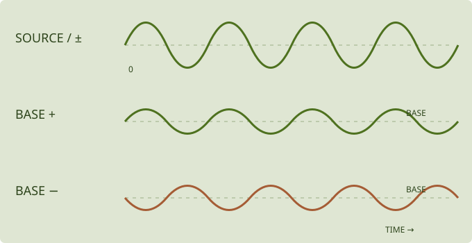

# Modulation in practice · patch examples

[Português](modulation.md) · [Main manual](README.en.md) · [Module guide](modules.en.md)

The examples isolate one relationship at a time. Save the initial patch. Start with low physical output volume and small amounts. A recipe is a starting point, not a promise of an identical sound across versions or unrelated patches.

## Create, adjust and remove a route

1. Find the destination: SYNTH → FILTER / EG2 / OUTPUT for CUTOFF; select OP2 → OPERATOR for OP2 LEVEL.
2. Use the destination's **+** to choose a source, or the edition's source-to-destination assignment gesture.
3. Adjust the route's bipolar mini knob. Check its source name as well as its colour.
4. Edit the source in MOD. LFO 1 and LFO 2 are distinct; ENV 1 is not OP1's own envelope.
5. Compare amount zero with a small active amount. Remove the route explicitly when no longer needed; zero depth is not deletion.

Menus and available gestures differ between plugin and web/APK. The large knob is the **base**; the mini knob is **depth**; source SPEED is **rate**.

A harmonic-rich wave such as SAW HD makes filtering easier to hear than an isolated sine. For FM examples, use [USER with OP2 feeding OP1](modules.en.md#user-row-sends-column-receives), only OP1 directly out. Other connections can alter the comparison.

## Patch 1: moving cutoff

**Start:** a sustained harmonic-rich sound, voice filter enabled, CUTOFF away from its limits, EG2 INT at zero to isolate the route.

1. Choose a slow LFO 1 in MOD.
2. Assign **LFO 1 → CUTOFF** with a small positive depth.
3. Compare zero, small and larger depth; then reverse the sign.
4. Change SPEED while keeping depth fixed.

Rate changes how often the filter moves; depth changes how far. If cutoff rests at its extremes, reduce depth or move the base. If the amplitude envelope ends quickly, holding a key may not provide sustained audio. SYNC relates the LFO to tempo where supported; a connected MIDI controller alone does not establish clock sync.

## Patch 2: velocity-dependent FM

**Start:** OP2 → OP1, only OP1 OUT, FM/SIN, ratios around x1/x2, OP2 at a low but effective level.

1. Set OP2's dedicated VEL influence to zero for this comparison.
2. Assign **VELOCITY → OP2 LEVEL** with small positive depth.
3. Play the same pitch with different velocities using a controller that sends them.
4. Compare against **VELOCITY → OP1 LEVEL**.

On OP2, this changes the modulation sent to OP1; on OP1, it mainly changes direct contribution. Perceived loudness can change in both cases. Fixed-velocity input cannot demonstrate soft/hard variation. Velocity is set at note onset; aftertouch is another message.

## Patch 3: a percussive opening

**Start:** sustained audio, filter on, lower CUTOFF, EG2 INT zero.

1. Choose **ENV 1** in MOD, separately from the operator envelope.
2. Use ADSR with short ATTACK, audible DECAY, zero SUSTAIN and short RELEASE.
3. Assign **ENV 1 → CUTOFF** with small positive depth.
4. Compare separate notes with a held note.

The envelope opens at note start and returns to its sustain level. Longer ATTACK changes an immediate opening into a gradual rise. EG2 INT is another way to apply the dedicated filter envelope; isolate one path before combining both.

## Patch 4: slow random variation

**Start:** OP2 modulating OP1; a non-integer ratio can emphasize a metallic structure. Leave OP2 LEVEL away from its limits.

1. Choose **RAND 1 → SAMPLE & HOLD** and a low SPEED.
2. Assign **RAND 1 → OP2 LEVEL** at small depth.
3. Compare short RISE/FALL with longer values.
4. Keep SPEED unchanged while comparing transitions.

SPEED determines new targets; RISE/FALL shape travel to them. A long transition may not reach a target before the next draw. RANDOM LOOP repeats a sequence; LENGTH selects length and FLIP changes replacement probability on return. With FLIP zero, its existing pattern repeats.

## Patch 5: one macro, several destinations

**Start:** a filter-responsive patch, active DELAY in FX A, active ROOM in AUX, audible SEND/RETURN.

1. Centre MACRO 1 at zero.
2. Assign **MACRO 1 → CUTOFF**, **MACRO 1 → DELAY MIX**, **MACRO 1 → AUX SEND**.
3. Start with small positive depths; adjust each independently.
4. Move the macro both ways and compare.

Macros are bipolar; negative movement can reduce the same destinations. A route does not create or enable an absent effect. PLAY snapshots A–D store macro positions: they can recall different amounts of this gesture, but do not morph between complete presets.

## Patch 6: the wheel controls LFO depth

**Start:** a working cutoff example and a wheel sending CC1. Remove the direct LFO 1 → CUTOFF route to isolate the combiner.

1. Set **COMB 1 → MULTIPLY**.
2. Choose **SOURCE = LFO 1**, **MOD = MOD WHEEL**, **AMOUNT = +1 / +100%**, according to display units.
3. Assign **COMB 1 → CUTOFF** at small depth.
4. Compare wheel zero, halfway and full, without changing LFO SPEED.

At that AMOUNT, the result is LFO × wheel. Other AMOUNT settings blend influence and are not pure multiplication. The wheel controls extent, not rate. Movement at wheel zero may indicate another active route.

## Patch 7: per-note pressure and timbre

In the plugin, set MOD → KEYBOARD → **MPE INPUT → LOWER ZONE / CH 1 MASTER**. Channel 1 is master; channels 2–16 carry per-note expression. Match NOTE BEND to the controller's range.

| Input | Route or setting | Compare |
|---|---|---|
| Pressure | AFTERTOUCH → CUTOFF | Different pressure on two held notes |
| Timbre | TIMBRE (CC74) → OP2 LEVEL | Per-note timbre gesture changes FM intensity |
| Pitch bend | NOTE BEND range | Each note follows its own bend |

Begin with one route and note, then two. A shared bus effect is not evidence of per-note independence. Channel expression alone is not per-note MPE. Controller, transport and destination must support the same setup; touch height, pressure and CC74 are not inherently the same axis.

## Combining sources and diagnosing a patch

ENV 1 → CUTOFF can define note shape while LFO 1 → CUTOFF adds continuous movement. Start with one route, add the other gradually and keep the base away from limits. Removing one does not remove the other.

Operator envelopes, ENV sources, LFO resets, random sources and instance effects have different scopes. Do not assume a separate random draw per finger or separate bus effects per voice. A global macro remains global even when controlled by MIDI.

If no change is audible, check source activity, correct destination, route depth/sign, source trigger/clock, operator level/envelope, active filter/effect and other routes. Compare with depth zero before adding gain. Receiving a message does not guarantee that the preset uses it.
