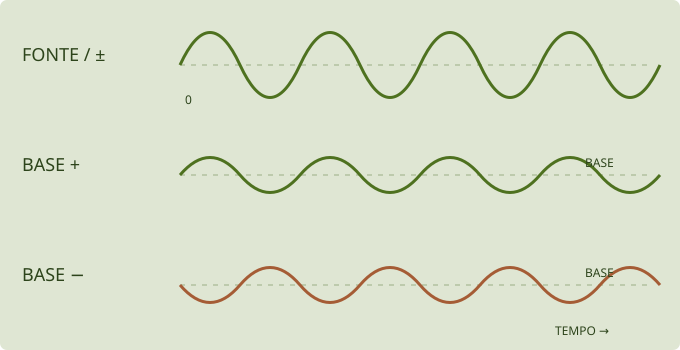

# Modulação na prática · patches ilustrados

[English](modulation.en.md) · [Manual principal](README.md) · [Mapa das telas e módulos](modules.md)

Modular é deixar uma fonte movimentar um ajuste. A fonte pode ser uma oscilação, um envelope, uma sequência ou o gesto de uma pessoa. Aqui vamos construir uma relação por vez, perceber sua contribuição e depois combinar movimentos.

**ALFA · receitas de estudo.** São instruções para montar patches, não arquivos de preset ou demonstrações de áudio já validadas. Os desenhos explicam relações; não são capturas da interface nem medições do motor. Os pontos de partida sugeridos devem ser ajustados ao timbre e à versão usada.

## Escolha uma experiência

| Quero explorar… | Receita |
|---|---|
| Movimento contínuo | [Um filtro que respira](#patch-1-um-filtro-que-respira) |
| Resposta à força de cada nota | [FM que muda com a velocidade](#patch-2-fm-que-muda-com-a-velocidade) |
| Uma transformação que começa a cada nota | [Uma abertura percussiva](#patch-3-uma-abertura-percussiva) |
| Variação menos repetitiva | [Metal que se transforma devagar](#patch-4-metal-que-se-transforma-devagar) |
| Vários destinos com um gesto | [Uma macro de aproximação](#patch-5-uma-macro-de-aproximacao) |
| Movimento sob controle da roda | [A roda libera o movimento](#patch-6-a-roda-libera-o-movimento) |
| Expressão diferente em cada nota | [Pressão e timbre por MPE](#patch-7-pressao-e-timbre-por-mpe) |

## Antes de criar uma rota

Salve o timbre atual. Escolha INIT para um começo conhecido ou use um preset seu e anote suas rotas existentes. Comece com volume moderado. Primeiro confira que uma nota soa e termina como esperado; depois acrescente movimento.

**Nesta documentação, patch é o conjunto de ajustes do som. Rota é uma ligação de modulação.** Um patch pode conter várias rotas e nenhuma sequência de notas.

Para observar alterações de filtro, uma onda com harmônicos, como **SAW HD**, costuma revelar melhor o recorte que uma senoide isolada. Para estudar FM, use uma ligação simples de OP2 para OP1, como no [exemplo USER](modules.md#user-linha-envia-coluna-recebe). Outras ligações e saídas diretas podem alterar o resultado das receitas.

## Criar, ajustar e remover na interface

1. **Encontre o destino.** Para CUTOFF: SYNTH → FILTER / EG2 / OUTPUT. Para LEVEL de OP2: selecione OP2 na visão geral e abra OPERATOR.
2. **Crie a ligação.** Use o **+** junto ao controle e escolha a fonte. A interface também oferece arrastar uma fonte até o destino.
3. **Ajuste a quantidade no mini knob** da rota. Arrastar verticalmente muda sua profundidade e sinal. Confira o nome da fonte; a cor sozinha não identifica a ligação com segurança.
4. **Edite a fonte em MOD.** Escolha a família, depois o módulo correto: LFO 1 não é LFO 2; ENV 1 não é o envelope próprio de OP1.
5. **Compare.** Leve temporariamente a quantidade a zero e retorne ao valor escolhido. Isso isola a contribuição da rota sem precisar apagá-la.
6. **Para desfazer a ligação**, use a opção de remoção da rota. Quantidade zero e remoção são estados diferentes.

As janelas, menus e espaços disponíveis variam entre plugin e web/APK. Na web/APK, o gráfico do destino e a lista de rotas também ajudam a conferir o estado. Essas instruções não pressupõem que uma apresentação visual específica já esteja disponível em todas as edições.

## Base, movimento e profundidade

O **knob grande** é o valor de base. O **mini knob** diz quanto uma fonte pode deslocar esse valor. **SPEED** pertence à fonte e escolhe a rapidez do movimento. São três decisões independentes.

*Exemplo conceitual. A linha tracejada representa a base; as curvas não usam escala de frequência, volume ou tempo do instrumento.*

- **Fonte bipolar:** pode ficar acima e abaixo de zero. Uma rota positiva pode levar o destino para ambos os lados da base.
- **Fonte unipolar:** percorre um lado de zero. Uma rota positiva desloca para um lado; negativa desloca para o outro.
- **Quantidade negativa** inverte a influência da fonte; não transforma obrigatoriamente seu desenho em uma forma diferente.
- **Limites do destino:** perto do máximo ou mínimo, parte do movimento pode ficar limitada. Aumentar profundidade pode então parecer produzir pouco efeito.

No motor atual, a quantidade representa uma parcela da faixa do destino. **+10% de rota não significa +10 Hz, +10 dB ou mais 10% do valor mostrado.** O resultado depende da escala e dos limites daquele parâmetro. Por isso, comece com profundidade pequena e confira o valor e o resultado.

## Patch 1: um filtro que respira

**Intenção:** abrir e fechar o brilho de forma contínua, sem precisar mover o controle o tempo todo.

**Ponto de partida:** um operador ouvido diretamente, onda SAW HD, nota sustentada e filtro ligado em LPF 12 ou LPF 24. Deixe RESO baixa. Coloque CUTOFF numa região em que fechar e abrir produza diferença. Para isolar o LFO, deixe EG2 INT em zero e confira que outras rotas não estão movendo o mesmo destino.

<!-- visual:patch-breath -->

1. Em MOD → LFO, escolha **LFO 1**, forma SIN ou TRI e movimento lento. Para começar, FREE em torno de **0,5 Hz**, se oferecido na edição, faz um ciclo levar aproximadamente dois segundos.
2. No CUTOFF, adicione LFO 1. Comece com quantidade positiva pequena, por exemplo **+5% da faixa**.
3. Sustente uma nota e acompanhe o desenho do LFO. Compare quantidade zero, pequena e maior.
4. Inverta a quantidade para ouvir/observar a direção contrária. Depois altere SPEED sem alterar a quantidade.

**O que observar:** a velocidade muda a frequência do abrir/fechar; a profundidade muda sua extensão. Se o filtro parecer estacionar nas pontas, reduza a quantidade ou afaste a base de seus limites. Se o envelope do operador terminar rápido, segurar a tecla pode não fornecer um som contínuo para a experiência.

**Variação:** escolha uma divisão de SYNC quando disponível. O movimento passa a se relacionar ao andamento; no plugin, o transporte e o tempo vêm do host. Não deduza sincronismo apenas porque um controlador MIDI está conectado.

## Patch 2: FM que muda com a velocidade

**Intenção:** fazer a força de cada nota mudar a transformação de FM, além de seu volume.

**Ponto de partida:** USER com OP2 → OP1, somente OP1 em OUT. Ambos em FM/SIN, razões x1 ou x2; OP1 com nível confortável e OP2 com nível baixo, mas audível em sua influência. Confira os envelopes dos dois. Salve antes de limpar ligações de um patch existente.

<!-- visual:patch-velocity -->

1. Selecione **OP2**, abra OPERATOR e localize LEVEL.
2. No + de LEVEL, escolha **VELOCITY** e comece com uma profundidade positiva pequena.
3. Toque a mesma nota com forças diferentes em um teclado/controlador que envie velocity, ou use a configuração de velocidade oferecida pela edição.
4. Compare a rota em zero e ativa. Depois compare com uma rota de VELOCITY para LEVEL de OP1.

**O que observar:** sobre OP2, a velocidade altera a intensidade da modulação enviada a OP1. Sobre OP1, altera principalmente sua contribuição direta. A percepção de volume também pode mudar no primeiro caso; não são efeitos completamente independentes.

**Importante:** o controle dedicado **VEL** do operador também pode alterar sua resposta à velocidade. Para estudar só a rota, comece com esse controle em zero. Um controlador com velocity fixa não produzirá a comparação entre toques leves e fortes.

## Patch 3: uma abertura percussiva

**Intenção:** o filtro abre no começo de cada nota e volta a fechar, mesmo com a tecla ainda pressionada.

**Ponto de partida:** a mesma onda rica em harmônicos, filtro ligado, CUTOFF mais fechado e EG2 INT em zero. O envelope de amplitude do operador deve permitir duração suficiente para perceber o movimento do filtro.

<!-- visual:patch-envelope -->

1. Em MOD → ENVELOPES, escolha **ENV 1**. Aqui estamos usando uma fonte de modulação, não o envelope próprio do operador.
2. Comece em ADSR: ATTACK curto, DECAY visível, SUSTAIN em zero e RELEASE curto. Como referência de gesto, experimente decay de algumas centenas de milissegundos conforme o valor exibido.
3. Crie **ENV 1 → CUTOFF**, com quantidade positiva pequena.
4. Toque notas separadas e depois sustente uma. Confira que o desenho do envelope retorna ao nível de sustain escolhido.

**O que observar:** cada nota inicia uma trajetória. Diferentemente de um LFO livre, esse gesto tem relação com o início e a duração da nota. ATTACK maior transforma a abertura imediata em crescimento gradual.

**Outra forma de chegar lá:** o filtro já oferece **EG2 INT** para aplicar seu envelope dedicado. Use esse caminho ou a rota da receita para começar; usar ambos sem perceber soma influências e dificulta entender a origem do movimento.

## Patch 4: metal que se transforma devagar

**Intenção:** variar a intensidade da transformação sem repetir sempre a mesma curva.

**Ponto de partida:** OP2 modulando OP1, com uma relação não inteira se quiser explorar uma estrutura metálica. Deixe OP2 longe dos extremos de LEVEL, pois a variação pode subir e descer em torno da base.

<!-- visual:patch-random -->

1. Em MOD → RANDOM, escolha **RAND 1 → SAMPLE & HOLD**.
2. Use uma velocidade baixa, para distinguir um valor do seguinte.
3. Ligue **RAND 1 → OP2.LEVEL** com profundidade pequena.
4. Primeiro deixe RISE/FALL curtos para perceber os patamares. Depois aumente ambos e compare a transição entre os mesmos tipos de evento.

**O que observar:** SPEED escolhe quando novos alvos aparecem; RISE e FALL escolhem como subir e descer até eles. Uma transição muito longa pode não alcançar o alvo antes do sorteio seguinte. Isso é diferente de simplesmente diminuir SPEED.

**Variação:** RANDOM LOOP guarda uma sequência que retorna. LENGTH define seu comprimento; FLIP controla a chance de substituir valores quando o laço volta. Com FLIP em zero, o padrão existente se repete, em vez de ser renovado a cada volta.

## Patch 5: uma macro de aproximação

**Intenção:** um gesto abre o filtro e aumenta a participação dos efeitos.

**Ponto de partida:** um timbre que responde ao filtro, um DELAY colocado e ligado em FX A, e ROOM colocado e ligado no AUX. Confira que SEND e RETURN permitem ouvir o AUX. Uma rota para um efeito ausente ou desligado não cria esse efeito.

<!-- visual:patch-macro -->

1. Coloque **MACRO 1 no centro/zero** e mantenha seus destinos longe dos limites.
2. Crie três rotas: MACRO 1 → CUTOFF; MACRO 1 → MIX do DELAY; MACRO 1 → AUX SEND.
3. Use profundidades positivas pequenas. Ajuste uma rota por vez; o filtro e os efeitos não têm a mesma escala de resposta.
4. Mova a macro para os dois lados. Depois mantenha apenas o lado que combina com seu gesto de performance.

**O que observar:** a macro não escolhe um preset novo. Ela desloca vários destinos do patch atual. Como as macros são fontes bipolares, mover para o lado negativo pode fechar/reduzir os mesmos destinos, respeitando seus limites.

**Na PLAY:** os instantâneos A–D guardam posições das quatro macros. Com esta receita, guardar duas posições de Macro 1 permite transitar entre duas intensidades do gesto. Isso ainda não é morph entre presets completos.

## Patch 6: a roda libera o movimento

**Intenção:** o LFO só passa a ter influência quando a roda de modulação é movida.

**Ponto de partida:** um filtro que já responde ao teste do patch 1 e uma roda que envie **CC1**. Não use simultaneamente a rota direta LFO 1 → CUTOFF da primeira receita, para poder isolar o combinador.

<!-- visual:patch-comb -->

1. Em MOD → COMBINATE, selecione **COMB 1** e tipo **MULTIPLY**.
2. Escolha **SOURCE = LFO 1**, **MOD = MOD WHEEL** e **AMOUNT = +1 / +100%**, conforme a apresentação da edição.
3. Crie **COMB 1 → CUTOFF**, com profundidade pequena.
4. Compare a roda em zero, no meio e no alto. Mantenha SPEED do LFO constante.

Nesse ajuste específico, MULTIPLY faz o resultado corresponder a **LFO × roda**: roda em zero elimina essa contribuição; no meio, reduz; no alto, permite a extensão escolhida. Em outros valores de AMOUNT, esse combinador mistura influência e não deve ser entendido como um multiplicador puro.

**O que observar:** a roda controla a extensão do movimento, não sua velocidade. Se o corte se mover com a roda em zero, procure uma rota direta adicional ou outra fonte no mesmo destino.

## Patch 7: pressão e timbre por MPE

**Intenção:** modificar notas sustentadas separadamente, quando o controlador e o destino oferecem expressão por nota.

**Onde:** no plugin, MOD → KEYBOARD → MPE INPUT → LOWER ZONE / CH 1 MASTER. Os canais 2–16 carregam expressão por nota; o canal 1 é mestre. NOTE BEND deve corresponder ao alcance enviado pelo controlador.

| Mensagem | Rota de estudo | Resultado a observar |
|---|---|---|
| Pressão | AFTERTOUCH → CUTOFF | A pressão de uma nota modifica seu filtro |
| Timbre | TIMBRE (CC74) → OP2.LEVEL | O gesto de timbre modifica a transformação daquela nota |
| Bend | Alcance de NOTE BEND | A altura acompanha o gesto por nota; não é necessário criar uma rota de filtro para isso |

Comece com uma nota e uma rota; depois compare duas notas simultâneas com gestos diferentes. Não use um efeito compartilhado como prova de independência por nota. Se o controlador enviar apenas expressão de canal, o comportamento não equivale a MPE por dedo.

Esta receita exige dispositivo, transporte e roteamento compatíveis. Os gestos do celular dependem da edição do controlador; pressão, altura do toque e CC74 não devem ser presumidos como o mesmo eixo. Nenhuma validação física adicional foi realizada para este guia.

## Duas fontes no mesmo destino

Uma combinação comum é **ENV 1 → CUTOFF** para a trajetória da nota e **LFO 1 → CUTOFF** para movimento contínuo. Cada rota tem sua quantidade. O knob grande continua sendo a base.

1. Ajuste primeiro ENV 1 e deixe a rota de LFO em zero.
2. Acrescente o LFO aos poucos.
3. Compare uma nota recém-iniciada com uma sustentada.
4. Se o destino ficar preso em um extremo, reduza as profundidades ou mude a base.

Não espere que duas fontes percorram independentemente uma faixa ilimitada. Elas se combinam no destino, que tem limites. Retirar uma rota não retira a outra.

## Por nota, contínuo ou compartilhado?

- **Velocity** vem do início de cada nota. Uma nova pressão sobre a tecla não muda a velocity daquela nota; aftertouch é outro tipo de mensagem.
- **Envelopes de voz** acompanham eventos de nota. O envelope de OP2 e ENV 1 são fontes/processos distintos.
- **LFOs** podem ter comportamento livre ou redisparado conforme sua configuração. Trocar de forma não decide sozinho se há reset por nota.
- **RAND** pode manter um processo global; não presuma um sorteio exclusivo por dedo.
- **Efeitos e barramentos** são compartilhados pela instância. Uma fonte por nota aplicada a esses controles não transforma o efeito em seis efeitos independentes.
- **MPE** transporta expressão por nota, mas o destino precisa respeitar esse escopo. Um único macro global não se torna individual por nota apenas por receber MIDI.

## Se o resultado não aparecer

| Sintoma | Confira primeiro |
|---|---|
| Nenhum movimento | Rota criada, quantidade diferente de zero e fonte ativa |
| Gráfico se move, mas o som não | Destino ligado, operador participante, efeito no slot e mistura audível |
| Só uma parte da oscilação aparece | Base perto do limite e profundidade excessiva |
| A nota termina antes do movimento | Envelope de amplitude, gate e duração da nota |
| Toques diferentes dão o mesmo resultado | Velocity fixa, curva do controlador ou outra ligação dedicada |
| A roda em zero ainda deixa o LFO agir | Rota direta adicional, valor recebido da roda e configuração do COMB |
| Várias notas mudam juntas | Fonte global, mensagem de canal ou destino compartilhado |
| O som muda mais do que eu esperava | Mais de uma rota, EG2 INT ou VEL dedicados, macros e outras ligações já ativas |

Salve cada etapa com um nome que descreva o gesto. Para relatar uma dúvida, informe o destino, a fonte, a quantidade e o que já estava ativo. Uma imagem do destino com seus mini knobs e outra da página da fonte costuma mostrar mais que uma captura da tela inteira.
