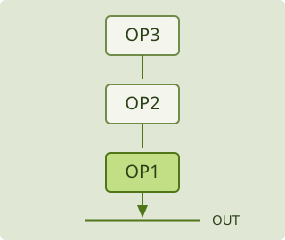
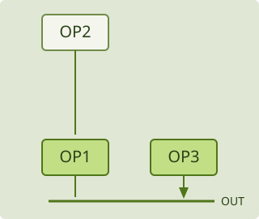
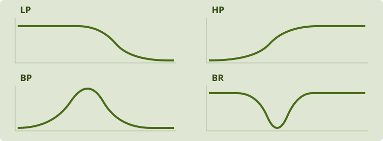

# Inside Usina · module guide

[Português](modules.md) · [Main manual](README.en.md) · [Installation](../INSTALL.en.md)

Find the screen, identify the control and compare one change at a time. This alpha guide distinguishes the plugin from the web/APK edition. Names in uppercase are interface labels. Illustrations describe signal relationships, not measured responses or exact screen positions.

## Screen map

| Task | Plugin | Web/APK |
|---|---|---|
| Choose a sound | Header library | Header TIMBRES button |
| Edit an operator | SYNTH → OP1–OP6 → OPERATOR | Same hierarchy; overview may be collapsed |
| Select synthesis | Selected operator's MODE | Selected operator's MODE |
| Shape its envelope | OPERATOR → ENVELOPE | Envelope controls and editable graph |
| Filter the voice | FILTER / EG2 / OUTPUT | Same page; feature availability depends on edition |
| Create modulation | SYNTH → MOD → source family | ENVELOPES, LFO, FUNCTIONS, RANDOM, COMBINATE |
| Change route depth | Destination mini knob or route list | Destination mini knob or route list |
| Edit a bus effect | FX → bus and slot | FX A, FX B, AUX, LOOP → slot |
| Edit a sequence | SEQ → LANE | SEQ → lane and available editor |
| Play pads | CABINE → surface | CABINE → ESTE APP → surface |
| Control the plugin | MIDI routing and remote protocol | CABINE → REMOTA (PLUGIN), or PLAY → SAÍDA MIDI |
| Use performance controls | PLAY | PLAY → PAINEL selects Everything, Macros or Keys |

Remote CABINE follows the connected plugin; it is not another independent patch. Hiding the overview or keyboard changes available screen space, not synthesis.

## Algorithms and signal direction

An algorithm connects the six operators and selects their direct outputs. It does not replace waves, envelopes or effects with a new preset. Save before comparing structures. An operator may be both audible directly and a source for another operator.

### Open the selector

In the plugin, use **ALGO…** in ALGORITHM. The supplied algorithm diagram also opens the selector. Choose one of 40 diagrams or USER. In web/APK, the ALGORITHM title opens selection; with USER selected, its diagram opens USER / MATRIX instead.

### Read the diagram

- Numbers identify OP1–OP6, not note order.
- Filled blocks connected to the output bar have a direct output, also identified as OUT.
- Outlined blocks can feed another operator without direct output; MOD identifies that role.
- Follow lines to the output bar. Ordinary paths descend from source to destination; loops and side returns need separate attention.
- A dark operator may be absent from this routing. A connected operator can still be silent because of LEVEL, MUTE or its envelope.

A carrier's LEVEL mainly changes its direct contribution. A modulator's LEVEL changes how strongly it transforms its destination. Selecting an OP card opens its controls; selection does not create a connection or enable direct output.

### Chain and parallel paths

These examples add arrows for instruction. They are not numbered reproductions of a library algorithm. MODE changes how each block responds to its input.

### USER: row sends, column receives

**Row OP2 × column OP1 means OP2 feeds OP1.** Diagonal cells feed an operator back into itself. These algorithm amounts are positive, unlike bipolar parameter-modulation depths.

In the plugin, USER shows an editable matrix in the algorithm area: vertical drag adjusts 0–100; double-click toggles 0/100. In web/APK, USER / MATRIX uses knobs in a dialog. OUT selects direct outputs.

1. Save, select USER and inspect its current cells; choosing USER does not promise to copy or clear the previous algorithm.
2. Enable only OP1 in OUT to isolate its direct contribution. Other cells may still feed it.
3. Ensure OP1 and OP2 have active modes, levels and envelopes.
4. Raise row OP2 → column OP1 gradually; compare with changing OP2 LEVEL.
5. Enable OP2 OUT to compare direct addition with its modulation contribution.

No enabled direct outputs can mean internal activity without audible output. Disabling OP2 OUT does not remove its modulation route.

### Three feedback controls

| Control | Scope |
|---|---|
| FM FB or USER diagonal | Operator/network feedback |
| ALG FB | Special return in algorithms 4, 6 and 34; inactive elsewhere |
| Global FEEDBACK / LOOP INSERT | Instance audio feedback path |

PHASE selects the available phase behavior. It is separate from the routing diagram and feedback amount.

## Shared operator controls

FREQ chooses RATIO or FIXED. COARSE selects the main ratio; FINE refines it. DETUNE is a fine pitch offset; TRANS transposes; FIXED HZ is used by fixed-frequency operation. LEVEL, VEL and VEL PITCH affect level and velocity response. Key tracking shapes response across the keyboard. The operator envelope and the separate ENV sources are different controls.

## Wave and processing modes

| MODE | Controls and purpose |
|---|---|
| FM | Phase-modulated wave; FB and WIDTH |
| RING | Multiplication; DEPTH and SHAPE |
| FILTER | Filtering inside an operator; TYPE, OSC MIX, CUTOFF, RESO |
| FILTER FM | Filtering and received modulation; controls differ from FILTER |
| FOLD | Wavefolding; GAIN, OSC MIX, BIAS |
| EFFECT | FX process inside the algorithm, with OSC MIX and contextual controls |
| BYPASS | Pass the received signal |
| MUTE | Silence the operator; may interrupt a necessary path |

Operator FILTER differs from the voice filters and FILTER in an FX slot. Compare the same input while changing TYPE; a level change is not a reason to add large gain immediately.

### EFFECT processes

| FX | Contextual controls | Purpose |
|---|---|---|
| PEAK EQ | FREQ, GAIN | Emphasize or attenuate a band |
| SHELV EQ | LOW, HIGH | Low/high balance |
| PHASER | FREQ, FB | Phase interference |
| RING | FREQ, MIX | Multiplication mixed with input |
| COMB | FREQ, FB | Very short repeats and comb resonances |
| DIST / DRIVE | DIST or DRIVE, LOW | Nonlinear processing and low-end balance |
| DEC | FREQ, BIT | Rate and resolution reduction |
| WAVESHAPER | SHAPE, DAMP | Transfer curve and damping |
| PUNCH | PUNCH, HIGH | Attack emphasis and high-end balance |
| STRING / TUBE / PLATE / BAR / SHEET / SPRING | FREQ, DECAY | Different resonance families |
| DISPERSE | FREQ, STAGES | Staged dispersion |

These processes occupy an operator's place in the algorithm. Use the FX page for processing after voices or in a bus.

## Objects, processes and recordings

### MODAL

MODE → MODAL exposes OBJECT and EXCITER. STRUCTURE, MATERIAL, SIZE and DECAY define resonance relationships, losses, pitch scale and energy persistence. BRIGHT, STIFF, POSITION, DENSITY and IRREG refine the object.

STRIKE hits, BOW rubs, BLOW blows, SCRAPE scrapes and DROP adds falling/bouncing impacts. PRESSURE, HARDNESS and STRIKE depend on the exciter. POSITION changes excitation location; TENSION couples movement and pitch; RATTLE adds noisy contact. DAMP damps after release. The operator envelope shapes excitation; the object can resonate after excitation ends. See [DAMP and DROP](voices.en.md#modal-damp-and-drop).

### CHAOS and STOCHASTIC

CHAOS uses MODEL, CHAOS, SHAPE and SMOOTH. Small changes can move between different regimes; this is not independent random drawing at each instant. STOCHASTIC evolves a waveform using DISTRIB, LVL STEP, POINTS and LEN STEP. These are separate processes with different controls.

### MACRO

MODEL selects a synthesis model; HARMONICS, TIMBRE and MORPH have model-specific meanings. This **operator mode is separate from the four performance macros** in MOD/PLAY. Model changes can substantially change level and character.

### SAMPLE

READ chooses ONCE, LOOP, PING-PONG or REVERSE. START/LENGTH select the region; XFADE softens LOOP joins; FADE treats the other read modes' edges. LEVEL and the operator envelope still apply. See [live capture](voices.en.md#sample-live-capture) for audio A–D, CAPTURE and AUTO LVL. Those audio positions are separate from PLAY macro snapshots. Bring referenced recordings when moving a project.

### UNISON and BITS

UNISON uses VOICES, DETUNE, MIX, DRIFT, SUB, PWM and operator WIDTH. Begin with one copy before adding detuning. More copies require more processing. BITS transforms waveform representation with BITS, XOR, KEEP and OFFSET. Binary COMB types transform control sources instead; the two are not interchangeable. See [voice details](voices.en.md#unison).

## Voice filters, EG2 and stereo

SYNTH → FILTER / EG2 / OUTPUT contains VOICE FILTER, EG2, LPG and OUTPUT. FILTER 1 and FILTER 2 select editing pages; ROUTE defines the audio relationship. [FILTER 2](voices.en.md#filter-2) documents SERIES, PARALLEL, STEREO and their different MIX laws.

| Family | Starting point |
|---|---|
| LPF 12/24 | Reduce high frequencies; compare nominal slopes |
| HPF 12/24 | Reduce lows below cutoff |
| BPF 6/12 | Emphasize a band |
| BRF 6/12 | Reject a band while retaining both sides |
| LPF SK / HPF SK / LPF OTA | Compare nonlinear DRIVE/RESO behavior |
| SK CASC (HP > LP) | Set the high/low cutoff regions before feedback |
| SK LPF HOT / SK HPF HOT | Start with low DRIVE/RESO |
| CMOS LP/HP/BP/DIST | Compare CMOS LIFE at zero and small amounts |

Slope numbers are nominal dB per octave, not output gain. EG2 INT applies the filter envelope; key tracking follows keyboard regions. The cascade has shared part state, not a separate independent filter for every note. OFFSET differs left/right cutoff. Voice WIDTH, PAN and SPREAD have distinct roles; see [stereo](voices.en.md#voice-and-operator-stereo).

### VCA and LPG

VCA is a gain stage controlled by a signal; its voltage terminology is historical in software. CASC VCA chooses GATE, EG2, ENV or SOURCE; SOURCE exposes VCA SOURCE. It is not LPG or master volume.

LPG means low-pass gate: level and low-pass filtering act together. MODE, SOURCE, RIGHT, R SOURCE and R DECAY define the main/right response. See [stereo LPG](voices.en.md#stereo-lpg). A closed LPG tends to make a signal quieter and darker; its control response is not simply another envelope.

## Envelopes and modulation

ATTACK reaches the peak; DECAY reaches SUSTAIN; RELEASE follows note release. SUSTAIN is level, not a fixed duration. ATK CURVE, CURVE and REL CURVE shape segments. ADR omits the sustained hold; RETRIG chooses a triggering source. Direct graph gestures vary by edition.

A route has a source, destination and bipolar amount. The destination's large knob remains its base value. A mini knob changes depth and sign; changing source SPEED changes movement rate. See [seven illustrated patches](modulation.en.md).

## Bus effects

FX A/B, AUX and LOOP INSERT each have three slots. NONE leaves a slot empty. Select a slot before editing. Bus power/mix and an effect's own controls are different stages.

| Effect | Controls to recognize |
|---|---|
| TEXTURE | Granular/delay processing, MEDIA, grain controls, density, pitch, freeze, mix/reverb |
| ROOM | AMOUNT and room character; AUX SEND/RETURN set its contribution |
| DISTORT | MODE, contextual character, tone and amount |
| IR | LOAD an impulse response you recorded, obtained free or bought under its licence; no IR is bundled |
| VAPOR | GRANULAR, STRETCH, LOOP DELAY, SPECTRAL, REVERB, RESONATOR; controls change with mode |
| DELAY | DIGITAL/TAPE, TIME/SYNC, WOW/FLUTTER where applicable, FEEDBACK, FREEZE, TAP |
| FILTER | TYPE, CUTOFF, RESO, DRIVE, SPREAD, FOLLOW, MIX; [units and limits](voices.en.md#filter-in-fx-slots) |

FREEZE and tails can retain sound. The optional VAPOR LIMIT starts off and does not replace the output guard or physical volume control. Loading an IR does not grant redistribution rights; keep referenced files with projects. Web/APK IR availability differs.

See [AUX and LOOP INSERT](routing.en.md) to distinguish send/return, bus mix and global feedback. To diagnose silence, check note source, operator output, envelope, filter, LPG, slots, bus power and final level in that order, comparing one stage at a time.
