# Voices, filters and capture

Guide to the plugin edition. Control names follow the native interface. This is an alpha; screenshots show the native interface in development. [Português](voices.md) · [Main manual](README.en.md) · [Module guide](modules.en.md) · [Routing](routing.en.md)

## FILTER 2

**Location:** SYNTH → FILTER / EG2 / OUTPUT → VOICE FILTER → FILTER 2. The tab selects the filter being edited; **ROUTE** selects the signal path.

| ROUTE | Signal path | MIX at 0% → 100% |
|---|---|---|
| OFF | Second filter excluded | No FILTER 2 contribution |
| SERIES | FILTER 1 → FILTER 2 | First filter alone → both in series |
| PARALLEL | Both filters receive the signal in parallel | First filter → second filter |
| STEREO | FILTER 1 on the left; FILTER 2 can replace the right filter | Right channel: first filter → second filter |

**TYPE** contains the voice-filter types except **SK CASC (HP > LP)**: LPF 12/24/SK/OTA, HPF 12/24/SK, BPF 6/12, BRF 6/12, SK LPF/HPF HOT and CMOS LP/HP/BP/DIST.

| Control | Function |
|---|---|
| CUTOFF | Cutoff displayed in Hz/kHz |
| RESO | Resonance, 0–100% |
| DRIVE | ×1–×8 input gain for saturating types; SVF types remain linear |
| EG2 INT | Bipolar amount of the shared EG2, displayed in semitones; no separate envelope is created |
| KEY | Tracking relative to KEY CTR, −200% to +200%; +100% moves one semitone per played semitone |
| MIX | Route-dependent blend as described above, not master volume |

**Try:** compare different filter cutoffs in PARALLEL while moving MIX. Select SERIES to hear FILTER 2 process FILTER 1. Start with low resonance.

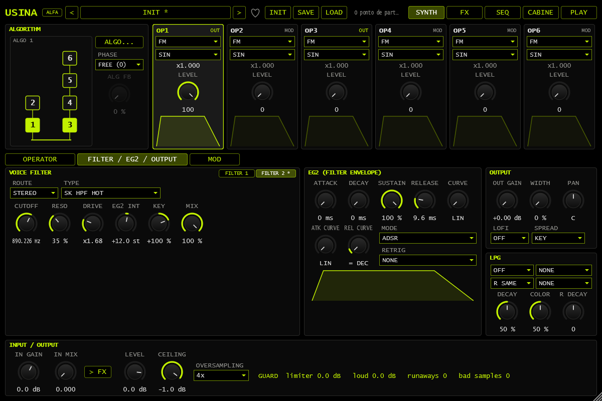

*FILTER 2 in STEREO, with MIX and the shared EG2.*

## FILTER in FX slots

**Location:** FX → FX A, FX B, AUX or LOOP → select a slot → FILTER. This bus effect processes the combined signal, rather than each voice separately.

| Control | Function |
|---|---|
| TYPE | Same applicable types as FILTER 2; no SK CASC |
| CUTOFF | 20 Hz–20 kHz |
| RESO | Resonance |
| DRIVE | ×1–×8 on saturating types; no effect on linear SVF types |
| SPREAD | Separates channel cutoffs by up to one octave each way; positive raises the right cutoff |
| FOLLOW | Positive opens with rising signal level; negative closes; zero disables following |
| MIX | Dry/filtered blend; AUX returns the filtered signal only |
| OUTPUT | Output gain, −24 to +12 dB |

**FOLLOW and dB:** the knob is displayed as a **bipolar percentage**, not dB. Its detector reads input level on a **−48 to 0 dBFS** scale. At full amount, the cutoff movement can reach four octaves. **OUTPUT** is the control expressed in dB. FOLLOW tracks amplitude, not played pitch or detected notes.

**Try:** use a pattern with attacks and gaps, moderate cutoff and positive FOLLOW. Compare with zero. Add a little SPREAD and also check the result in mono.

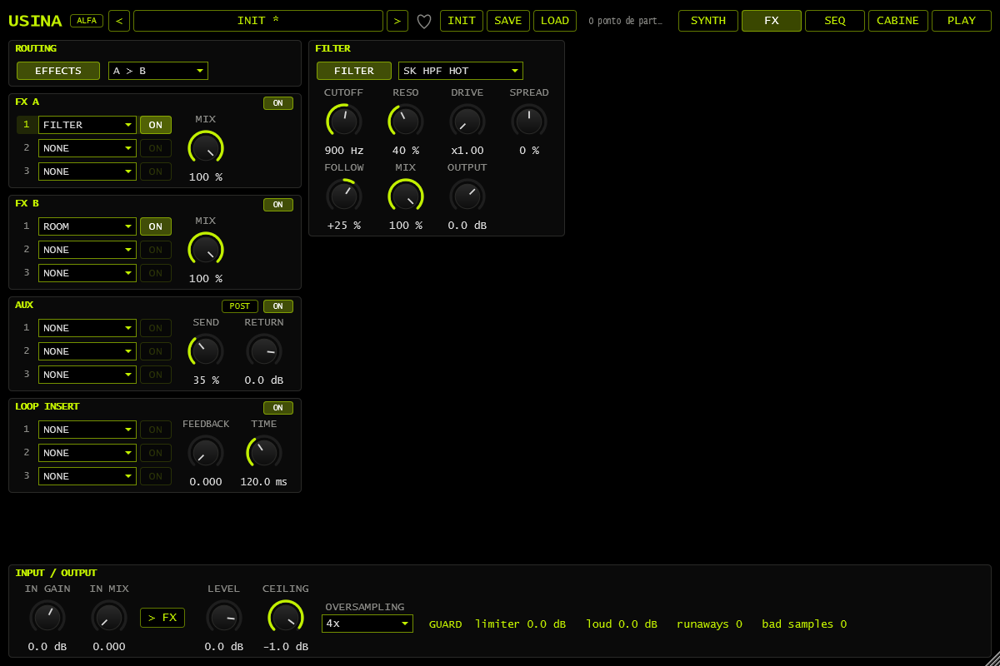

*FILTER in FX A slot 1; FOLLOW is displayed as a percentage.*

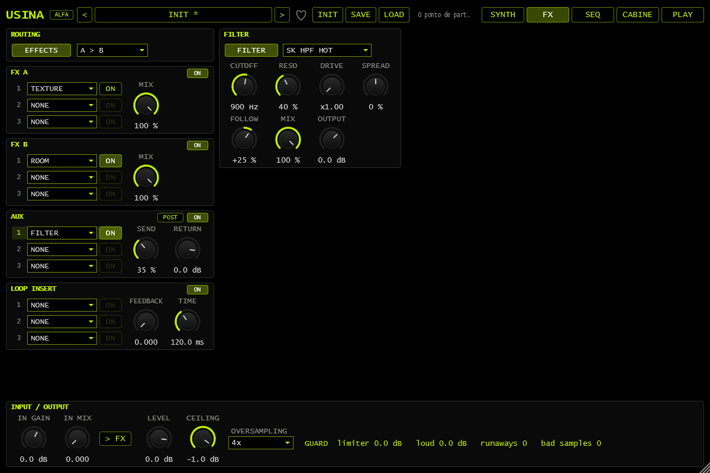

*FILTER in AUX, with POST, SEND and RETURN.*

## Stereo LPG

**Location:** SYNTH → FILTER / EG2 / OUTPUT → LPG, below output controls. A low-pass gate couples level and brightness; it does not replace operator envelopes.

| Interface control | Function |
|---|---|
| OFF / PING / EG2 / SOURCE | Main mode: note-triggered response, EG2 following or source following |
| SOURCE | Main source in SOURCE mode; bipolar −1…+1 is mapped to 0…1 |
| RIGHT: R SAME / R PING / R EG2 / R SOURCE | Right-channel mode, called R MODE in parameter data. R SAME shares the left gate; other choices use a separate gate |
| R SOURCE | Source when RIGHT is R SOURCE |
| DECAY | Main decay setting, 0–100 |
| R DECAY | −100…+100 offset added to the right decay setting, not a duration in seconds |
| COLOR | High-frequency content passing through the gate |

**Try:** use PING on both sides and a negative R DECAY. Compare the tails after a short note. SOURCE with an LFO creates periodic opening. RIGHT chooses a mode, not a pan position.

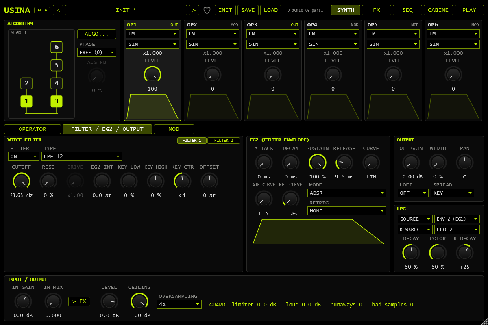

*LPG in SOURCE; right side in R SOURCE with its own source and decay offset.*

## CASC VCA SOURCE

**Location:** FILTER 1 → TYPE → SK CASC (HP > LP). **CASC VCA** selects GATE, EG2, ENV or SOURCE. With SOURCE selected, **VCA SOURCE** chooses the modulation controlling the cascaded stage level.

The cascade operates after the voices are summed. This VCA is separate from the LPG and master level. Select SOURCE first, then its source. An LFO can control the stage rhythmically; leave cascade feedback low while comparing settings.

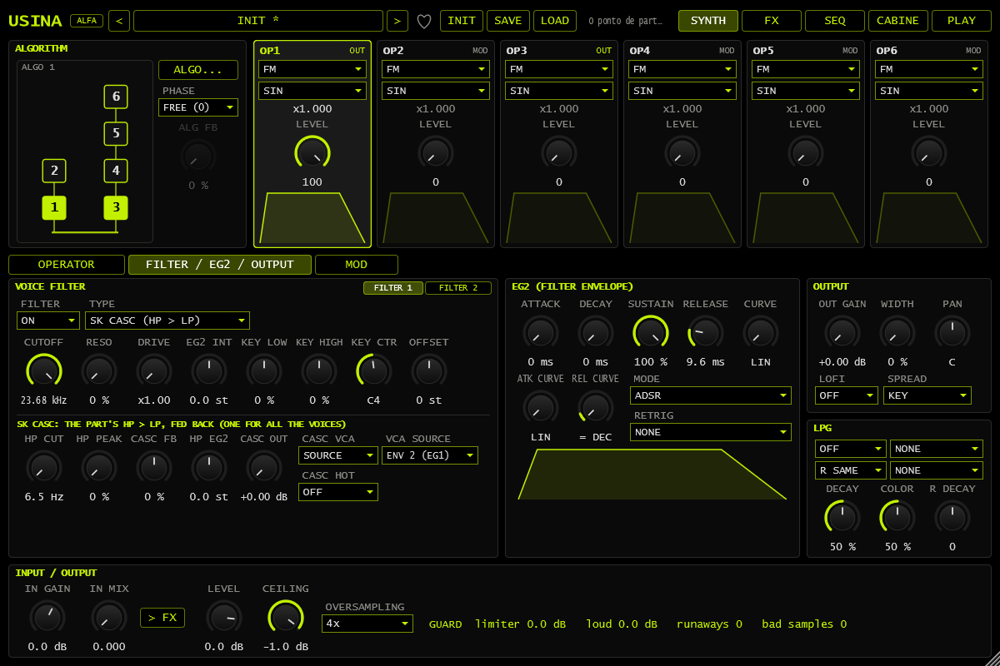

*SK CASC with CASC VCA set to SOURCE and VCA SOURCE selected.*

## Voice and operator stereo

**Location:** SYNTH → FILTER / EG2 / OUTPUT → OUTPUT.

- **SPREAD:** KEY places lower notes left and higher notes right; ALTERNATE alternates sides; RANDOM selects a position for each note.
- **WIDTH:** placement extent, 0–100%; zero centers the voices.
- **PAN:** overall left/center/right position. Modulation can move voices individually.
- Filter **OFFSET:** right cutoff relative to the left, −48…+48 semitones; not another absolute cutoff.

Operator **WIDTH**, in its MODE area, spreads UNISON copies or separates MODAL pickup positions. Output WIDTH positions complete notes. Operator WIDTH does not provide stereo expansion in every operator mode.

**Try:** compare consecutive notes with SPREAD ALTERNATE and output WIDTH. Then hold one UNISON note and change operator WIDTH to hear the distinction.

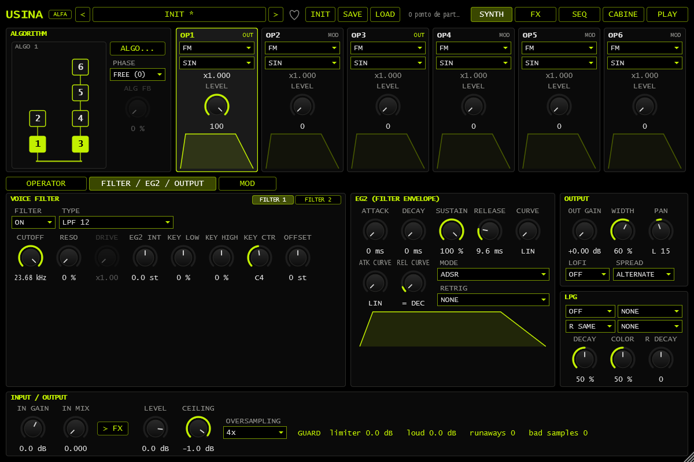

*OUTPUT: ALTERNATE distribution, WIDTH and PAN.*

*FILTER 1: right OFFSET at +7 semitones relative to CUTOFF.*

*UNISON operator WIDTH in the MODE panel.*

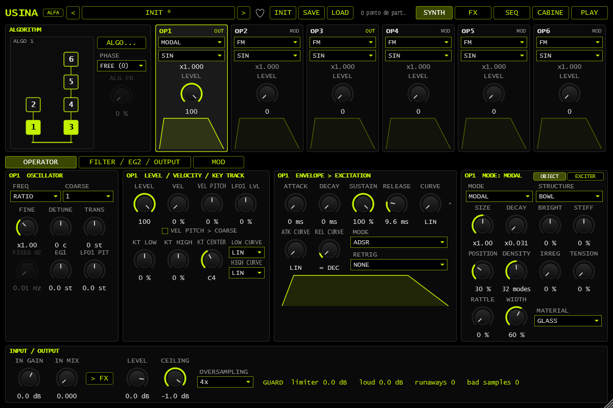

*MODAL WIDTH in the OBJECT tab, beside the object controls.*

## UNISON

**Location:** operator → MODE → UNISON. **VOICES** selects 1–9 copies, **DETUNE** separates tuning, **MIX** blends the center and side copies, and **DRIFT** slowly varies them. **SUB** adds a square wave one octave below; **PWM** moves square-wave pulse widths. **WIDTH** spreads copies in stereo. The operator still accepts algorithm modulation.

One voice or MIX zero provides the center-wave reference. Choose a square waveform to hear PWM; the control does not turn every waveform into a pulse.

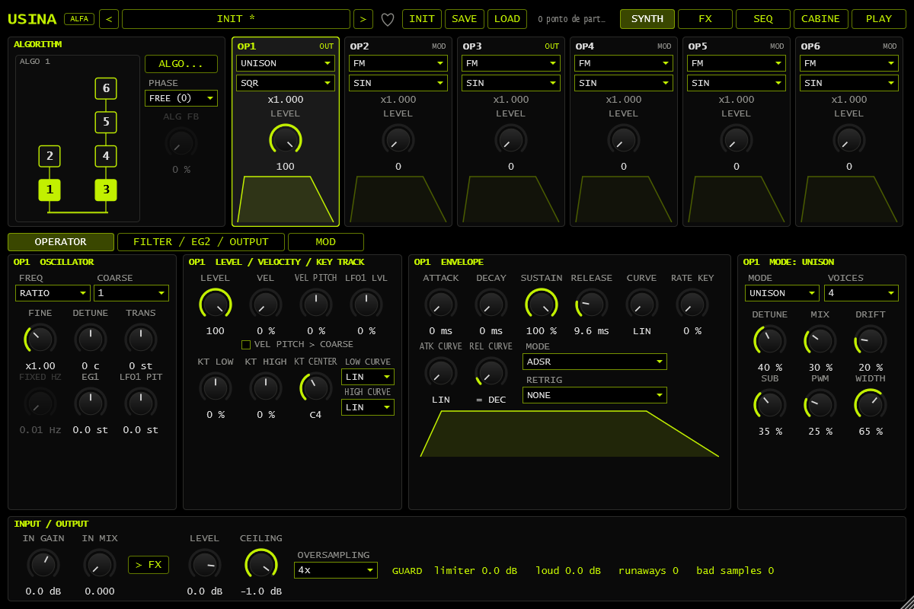

*UNISON with SQR waveform, SUB, PWM and WIDTH.*

## BITS and binary COMB

Operator **BITS** processes the waveform as numeric code. **BITS** selects 1–16-bit resolution, **XOR** flips masked bits, **KEEP** removes low bits and **OFFSET** adds with wraparound. This changes timbre; it is not note sequencing.

**COMB**, in SYNTH → MOD, transforms modulation sources. Binary types encode −1…+1 as an 8-bit value and decode the result:

| Type | Function |
|---|---|
| BIT | Extracts one bit as 0/1; AMOUNT selects the bit and negative values invert the gate |
| XOR | Combines SOURCE and MOD codes by bit inversion |
| AND | Retains high bits for positive AMOUNT or low bits for negative AMOUNT |
| ADD MOD 256 | Adds scaled MOD to SOURCE with byte wraparound |

**Try:** use a rising LFO as SOURCE, select BIT and route a small amount to a destination. Changing the bit creates related step patterns; it does not record sequencer notes.

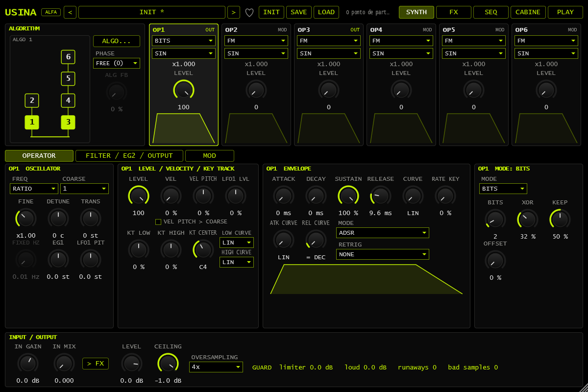

*BITS: resolution, XOR, KEEP and OFFSET.*

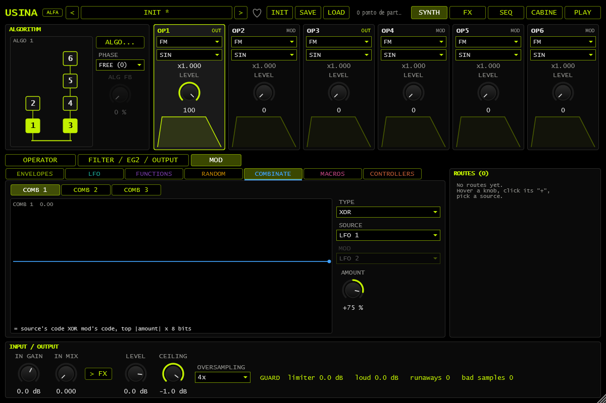

*Binary XOR COMB, sources and formula.*

## MODAL DAMP and DROP

**Location:** operator → MODE → MODAL. In the **EXCITER** tab, **DAMP** increases damping **after key release**. Zero retains natural ringing. It differs from DECAY and the excitation envelope RELEASE.

Select **DROP** in EXCITER for successive impacts representing a falling and bouncing object. STRIKE and excitation settings determine contact/energy for the configuration. DROP excites the voice; it does not add sequencer steps.

**Try:** release a resonating note and compare DAMP zero with a higher setting. Compare DROP impacts with a single STRIKE excitation.

*DAMP is in the MODAL EXCITER tab and controls damping after note release.*

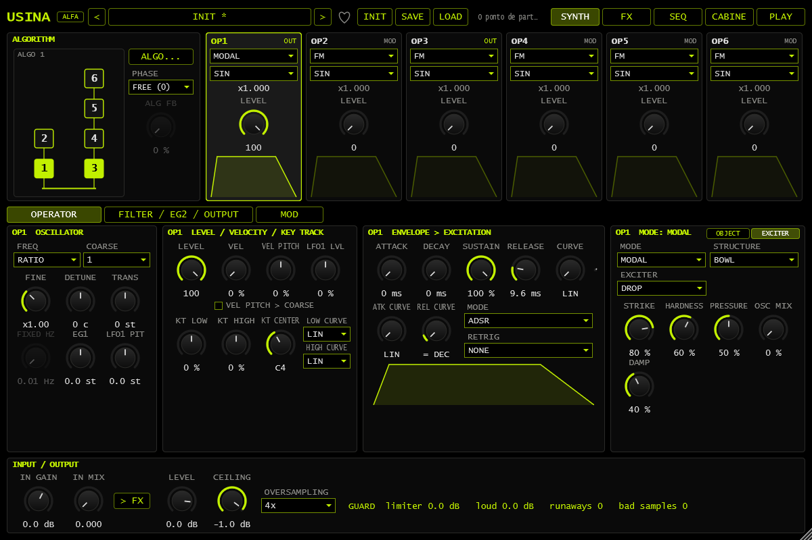

*DROP selected in the MODAL EXCITER tab.*

## SAMPLE live capture

**Location:** operator → MODE → SAMPLE. Recording controls provide **A–D**, LOAD, CAPTURE, CLEAR, LENGTH and AUTO LVL. A–D select recordings, independently of PLAY's macro snapshots.

1. Choose destination A–D and configure audio input. Capture follows IN GAIN and precedes IN MIX; IN MIX can stay at zero to avoid input monitoring.
2. Capture **LENGTH** is FREE, 1 BAR, 2 BARS or 4 BARS. With transport running, bar-length capture waits for the next bar. With transport stopped it starts immediately.
3. Press **CAPTURE**. Press again to end a free capture; bar-length captures stop automatically.
4. **AUTO LVL**, on by default, adjusts the take to a −3 dBFS peak, with gain increase limited to +30 dB. It cannot repair input clipping.
5. Play the recording and adjust READ, START, LENGTH and XFADE/FADE. Operator playback LENGTH is separate from capture LENGTH.

A take is saved as an audio file referenced by the preset/session. Keep those files accessible when moving projects; saving a preset does not embed the recording. Capture does not configure the audio interface or change project sample rate.

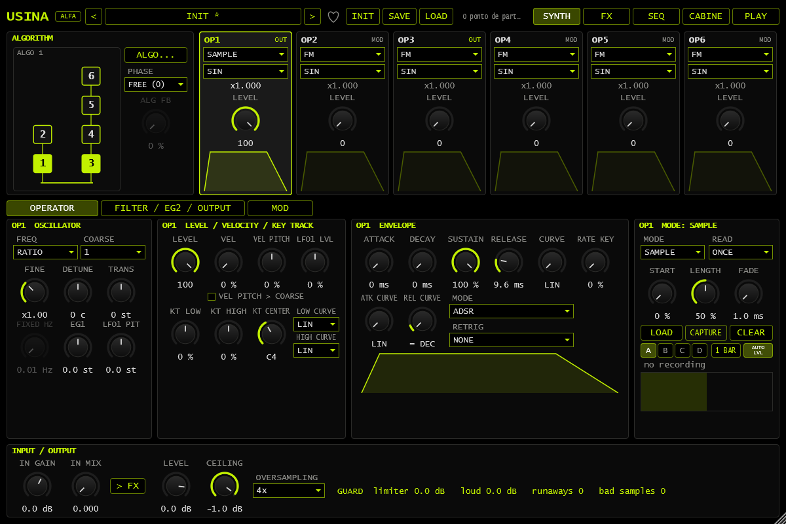

*SAMPLE: slots A–D, capture controls and LENGTH set to 1 BAR.*

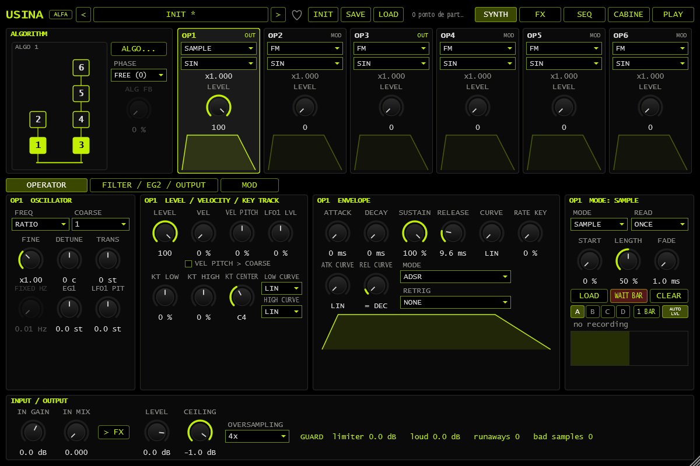

*Armed SAMPLE: WAIT BAR before capture begins.*
